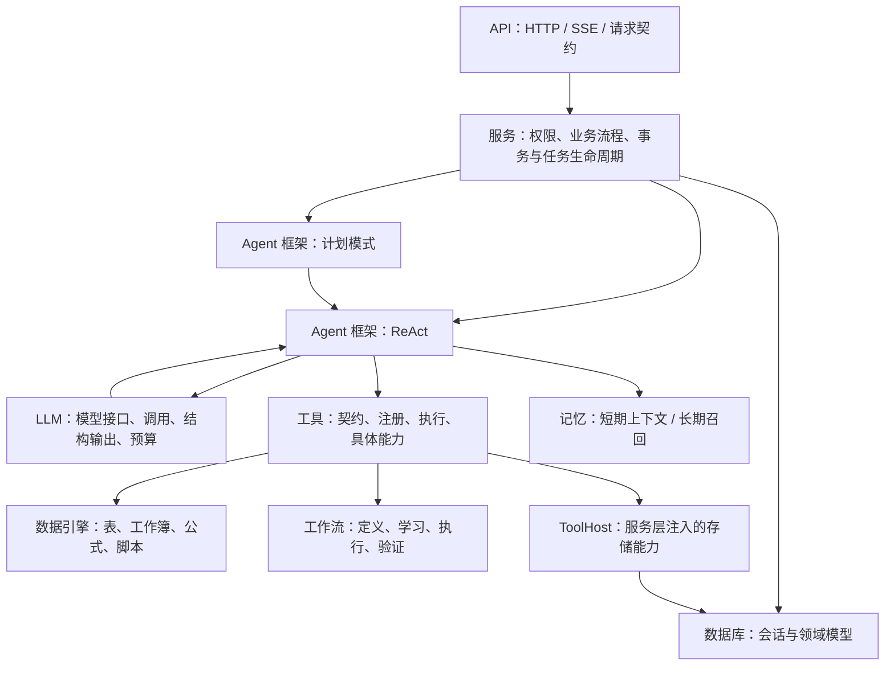

# 后端模块与扩展入口

请求从 `api/` 进入，由 `services/` 组织业务，再调用 `agent/`。
Agent 的四个组件是框架编排、模型、记忆、工具；工具通过数据引擎或工作流处理数据，
需要持久化的操作通过服务层注入的宿主访问数据库。



这是请求处理与依赖关系图。LLM、工具、记忆在一轮任务中可能多次交互，记忆也会在调用模型前提供上下文。
计划模式复用同一个 ReAct 执行器，执行预算、取消、工具结果和完成核对保持一致。

## 目录

```text
sheetmate/
├── app.py / __main__.py       应用装配、生命周期、HTTP 错误处理、启动
├── api/                      HTTP 层；各功能包包含 router.py、按需包含 schemas.py
│   ├── auth/                 登录、注册、用户资料
│   ├── customers/            客户、记忆与字段、客户公式
│   ├── conversations/        对话、上传、消息、执行控制与 SSE
│   ├── files/                文件信息、预览、下载
│   ├── recipes/              流程管理、重复执行、公式目录
│   └── runs/ scripts/ settings/ observability/ tool_results/
├── services/                 按业务功能封装的应用服务
│   ├── identity/ customers/
│   ├── conversations/        请求编排、历史、宿主、交付与查看文件
│   ├── execution/            任务、检查点、恢复、结果存储、临时工作区
│   ├── files/                持久化文件、上传检查、原始预览
│   ├── workflows/            流程存储、运行、重复执行、捕获、删除
│   ├── formulas/ scripts/ settings/ observability/
│   ├── memory/               作用域仓储、召回应用服务、字段映射、画像持久化
│   └── bootstrap/            初始化、示例资料
├── agent/                    Agent 四大组件
│   ├── framework/
│   │   ├── planning/         起草与审查计划、逐步执行、计划修复
│   │   ├── react/            工具循环、完成核对、恢复、反思、多 Agent
│   │   └── shared/           提示词装配、意图、证据、报告、工作流记录、等待控制
│   ├── llm/                  模型协议、客户端、结构输出、提示词、预算、缓存
│   ├── memory/
│   │   ├── short_term/       历史窗口、压缩、任务要求、上下文投影、执行状态
│   │   └── long_term/        抽取、证据策略、格式、可替换的检索评分器
│   └── tools/
│       ├── contracts.py      Tool / ToolResult / ToolHost / AgentContext
│       ├── registry.py       工具目录与按需加载
│       ├── execution.py      执行、超时、取消、清理
│       ├── worker.py         纯数据工具的独立进程入口
│       └── analysis/ files/ formulas/ interaction/ memory/ scripts/ workbooks/ workflows/
├── engine/                   可独立复用的确定性数据处理
│   ├── tables/               DuckDB 工作区、SQL、分析、字段映射、探测缓存
│   ├── workbooks/            读写、画像、保留格式、新建工作簿、图片、副本
│   ├── ooxml/                直接编辑 xlsx 内部 XML：改值、删行、插行、排序，未改动部件按字节保留
│   ├── formulas/             公式定义、内置算子、单步执行
│   └── scripts/              代码存储、引用、隔离运行器、子进程
├── recipe/                   可重复执行的工作流能力
│   ├── definition/           Schema、编译、输出计划
│   ├── learning/             输入匹配、差异、模型生成与结构契约
│   ├── execution/            确定性执行器、学习到交付的流程编排
│   └── validation/           自动校验、人工结果比对
├── db/
│   ├── session.py            连接、事务、建表与兼容升级
│   └── models/               身份、会话、执行、文件、流程、记忆领域模型
└── core/                     跨层基础能力
    ├── config/               进程配置、模型设置、策略类型
    ├── security/             隐私投影、持久化数据净化
    ├── observability/        对话追踪、日志
    └── errors.py             通用业务异常
```

## 模块边界

- **API** 处理请求契约、认证依赖、HTTP 和 SSE；业务计算交给服务。API 不导入 Agent、数据引擎或工作流实现。
- **服务** 负责业务作用域、事务、资源生命周期，以及把宿主和执行器装配起来；不依赖 FastAPI。
- **Agent** 通过 `ToolHost` 使用服务能力，通过 `LanguageModel` 使用模型能力；不导入 API、服务实现、ORM 或 SQLAlchemy。
- **引擎** 只依赖基础配置和自身模块，不依赖 Agent、工作流、服务或数据库。
- **工作流** 的确定性执行和校验可以单独使用；学习模块使用模型接口，执行器接收 `StepRepairer`，具体的 LLM 修复器由工具层注入。
- **数据库** 只依赖基础配置和领域模型；模型包统一注册元数据，避免遗漏建表或重复注册事件。
- **core** 不反向导入业务模块；日志中的会话存在性检查由应用入口注入。

同一功能优先在所属目录内修改。跨模块交互通过明确的输入、返回值或协议进行；不要把新的业务逻辑继续加到 `__init__.py`。
包初始化保持轻量，`agent.tools`、`agent.llm` 只延迟暴露常用公共接口。

## 后续改动位置

| 目标 | 优先修改的位置 | 稳定边界 |
| --- | --- | --- |
| 调整计划生成、审查 | `agent/framework/planning/` | `execute_thinking` 复用 ReAct 执行器 |
| 调整循环、反思、恢复 | `agent/framework/react/` | `AgentExecutor` 的事件流 |
| 接入其他模型服务 | `agent/llm/` | `LanguageModel`、`set_llm_factory` |
| 优化历史窗口或压缩 | `agent/memory/short_term/` | 来源保留、上下文预算 |
| 优化召回或增加向量评分 | `agent/memory/long_term/retrieval/` | `MemoryScorer` |
| 更换记忆持久化 | `services/memory/repository.py`、`db/` | 先过滤用户、客户、会话、流程作用域 |
| 增加工具能力 | `agent/tools/<功能>/` | `Tool`、`ToolResult`、`ToolHost` |
| 优化 Excel 处理 | `engine/workbooks/` | 读写结构、原件副本与输出结果 |
| 优化 OOXML 结构编辑 | `engine/ooxml/`、`engine/workbooks/ooxml_writer.py` | 直接改 xlsx 内部 XML：改值、删行、插行、排序、右侧追加列；未改动部件按字节保留 |
| 优化 SQL 与公式 | `engine/tables/`、`engine/formulas/` | 工作区、算子输入与执行结果 |
| 优化脚本隔离 | `engine/scripts/` | 输入副本、取消、超时和显式输出 |
| 修改流程执行与校验 | `recipe/execution/`、`recipe/validation/` | Recipe Schema、修复器协议 |

当前记忆召回是本地词项评分，不含向量库或 embedding 服务。向量实现可以放在
`long_term/retrieval/`，实现 `MemoryScorer` 并通过 `set_memory_scorer` 装配。
评分器只收到已授权候选，人工规则、证据约束、去重和预算仍由 selector 保证。
若还要新增向量索引的写入与持久化，需要在记忆仓储适配器中完成索引同步。

## 复用 Agent

已有执行器不创建 HTTP 请求或数据库会话。调用方准备模型、工作区、公式库和 `ToolHost` 实现，
构造 `AgentContext`，再将它传入 `AgentExecutor.execute`。需要计划模式时调用
`execute_thinking(executor, context, message, history)`，仍复用同一执行器和工具协议。
表格能力通过工作区和公式库注入；宿主可以使用本项目服务，也可以使用其他存储或测试替身。

模型替换使用 `LanguageModel` 协议；工作流修复使用 `StepRepairer` 协议；
记忆检索使用 `MemoryScorer` 协议。具体实现不需要进入执行器内部。

## 验证与启动

在项目根目录运行：

```bash
backend/.venv/bin/python -m pytest backend/tests -q
```

`test_architecture.py` 检查依赖方向、全部模块冷导入、真实工具子进程和资源路径；
`test_memory_boundaries.py` 检查评分器替换时的作用域、人工规则、去重和上下文预算。
已有测试继续验证 API、计划模式、聊天、执行取消、文件副本、工作流和 Excel 格式保留。

本次重构后共 196 项测试通过。独立的 `evals/run_offline.py` 在重构前后均为 45/47：
`relevant_memory` 和 `context_memory_relevant_recall` 两项既有样例缺少 AI 经验所需的执行证据，
被现行记忆策略排除。该结果已与重构前版本对照，未在目录重构中调整记忆策略或样例。

启动方式仍是在 `backend/` 运行 `python -m sheetmate`，项目根目录也可运行 `./start.sh` 或 `start.bat`。
默认数据位置仍为 `backend/data/`，前端接口、持久化表结构和现有数据格式保持兼容。
Python 内部导入路径已切换到新包；外部维护脚本如果直接导入旧模块，需要改用本文列出的路径。
