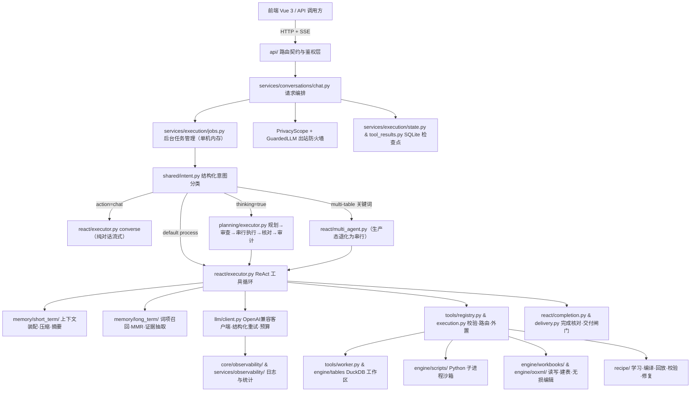
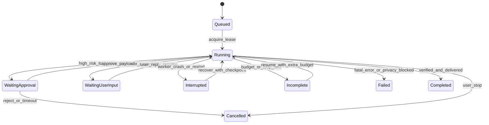
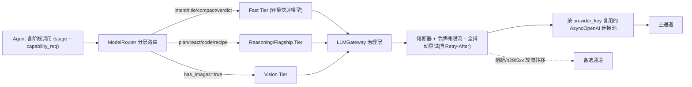
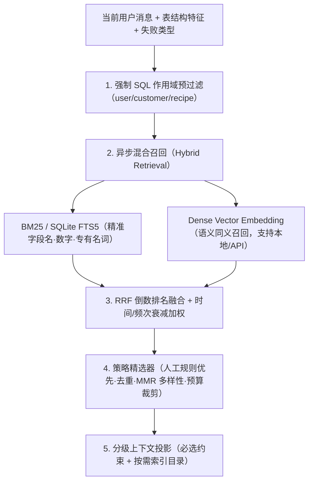

# SheetMate 后台 Agent 架构深度审计、演进优化方案与面试高频考点对标

> **文档日期**：2026-11-21  
> **审计范围**：`backend/sheetmate/{agent,services,engine,recipe,privacy,core,api,db}` 与 `backend/evals/`、`backend/tests/`  
> **目标**：将 SheetMate 后台从“强工程原型/单机高完成度专业 Agent”升级为**高成熟度、高稳定、高准确、安全可审计、具备完整评测闭环的企业级 Agent 后台**，同时全面覆盖并实证解决 Agent 架构面试中的高频核心问题与真实生产大坑。

---

## 一、总览与核心判断

### 1.1 现状总体评价：已经具备很强的工程底座

经过对全量后台源码的逐层审计，SheetMate 并不是市面上常见的“LangChain 套壳 / 简单 ReAct Demo”，它在**领域深水区**已经具备相当扎实的设计：

| 维度 | 当前已具备的硬核工程能力 | 对应核心代码 |
| --- | --- | --- |
| **分层解耦** | 严格单向依赖（`api -> services -> agent -> engine/recipe`），由 `test_architecture.py` 通过 AST 自动化守卫 | `backend/tests/test_architecture.py` |
| **混合计算范式** | **公式 / SQL 优先 + 受限 Python 兜底 + 声明式建表 + OOXML 无损局部编辑**，且能把探索轨迹零 LLM 编译为确定性可复用 Recipe | `engine/formulas/`、`engine/ooxml/`、`recipe/definition/compiler.py` |
| **反幻觉与证据闭环** | 工具调用前拍快照、返回不可变 `ev_<uuid>` 证据、完成核对（本地规则 + 证据引用检查 + 冲突收敛）、思考模式逐项核对与最终回答审计、候选文件延迟交付 | `agent/framework/shared/evidence.py`、`react/completion.py`、`planning/executor.py`、`services/conversations/delivery.py` |
| **上下文工程基础** | `ContextBlock` 优先级装配 + 必填防截断 + 省略回执、`stage_history` 首尾锚点保留、两级工具结果外置（`tr_<sha256>` 分页回查 + 请求期旧交换压缩）、CAS 历史滚动摘要 | `agent/memory/short_term/`、`agent/tools/results.py` |
| **可信长期记忆** | 强制逐字原文证据对齐（防大模型脑补污染）、人工规则最高优先级、`version` 乐观锁防并发覆盖、严格作用域预过滤 + MMR 去重 | `agent/memory/long_term/`、`services/memory/` |
| **崩溃恢复原型** | `AgentExecution` 乐观锁检查点 + 写前 `AgentToolReceipt` 幂等回执 + `side_effect` 重放拦截 + 检查点内容寻址分块外置 + 断线不中断后台任务 | `services/execution/{state,control,jobs}.py` |
| **隐私脱敏防火墙** | 失败关闭（Fail-Closed）的 `GuardedLLM` 出站拦截 + 确定性 HMAC 令牌 + OOXML 原地脱敏 + 仅下载时还原 | `privacy/`、`services/privacy/`、`agent/llm/guarded.py` |

### 1.2 迈向“极度成熟、稳定、准确”必须跨越的 5 道坎

代码审计同样暴露出**若干隐藏较深的真实 Bug、安全漏洞和架构短板**（如果上线高并发/多租户场景，或在高级 Agent 架构面试中被深挖，都会成为明显扣分点）：

1. **安全与稳定性上的 P0 真实漏洞（需立即止血）**：
   - `ExecutionControl.start_tool` 里硬编码了 4 个已改名的旧只读工具名，导致只读工具崩溃也会被误判为 `side_effect=True` 而**永久阻断恢复**；
   - 脱敏模块的 `email` 与 `im` 在生产初始化后被**静默关闭**（但自检却通过了），且 `Vault` 实为**明文 SQLite** 且跨租户全局共享；
   - Python 脚本沙箱在 **Windows 上零隔离**，Linux/macOS 的 `setrlimit` 因单 `try/except` 顺序问题可能静默跳过 `RLIMIT_AS`，且数据子进程 `worker.py` 既透传了全部 `os.environ` 凭据又在父进程直接 `pickle.loads`。
2. **编排层的“半成品断层”**：
   - 多智能体并行分支因生产态恒定注入 `ctx.runtime` 而**永久走串行死代码分支**；
   - Thinking/Plan 模式崩溃恢复时会**丢弃计划栈**退化为扁平 ReAct，且无真正结构化动态重规划与并行 DAG 执行；
   - `ask_user` 是回合终止型而非真正的 **Suspend/Resume HITL 中断**，还存在错误暴露 `can_resume=True` 的状态机漏洞。
3. **模型治理、KV Cache 与流式体验的结构性瓶颈**：
   - 全局单模型（无快/慢/推理/视觉分层路由）、无跨供应商降级/熔断、无 Jitter 与 `Retry-After`、未传 `stream_options={"include_usage": True}`、连接池泄漏；
   - 动态拼接系统提示词 + 回合中途 `load_tool_group` 修改 `tools` + `prepare_context` 改写历史前缀，导致 **Prompt KV Cache 反复失效**；
   - 所有带工具的任务 `live=False` 整段缓冲，加上完成核对与交付筛选阻塞，导致极高 TTFT（首字延迟），且缺少 SSE 心跳与 `Last-Event-ID` 断点续传。
4. **记忆检索与工具生态的规模化天花板**：
   - 长期记忆纯靠字面 N-gram 重合（无 BM25 / 向量 / 混合召回 / Rerank），无 TTL/衰减/遗忘，且人工规则超 12K 直接报错崩溃；
   - 无 **MCP（Model Context Protocol）** 接入、无声明式工具风险分级与动态 Tool RAG。
5. **可观测性、分布式运行与评测闭环缺失**：
   - 全程单进程内存态（`JobManager` / DuckDB LRU 无引用计数驱逐会关掉运行中工作区），事件循环内存在大量同步 SQLite、文件 SHA256 与全局锁日志 I/O；
   - 缺少 OpenTelemetry Span 树、精准成本核算（FinOps）、故障轨迹回放，以及最重要的——**端到端真实模型评测集（Golden Workbooks + Trajectory Eval + LLM-as-a-Judge + CI 回归门禁）**。

---

## 二、当前后台 Agent 整体架构全景



---

## 三、按 Agent 架构分层的深度分析与优化方案

下面严格按照现代生产级 Agent 系统的 **6 大核心架构层**，逐层给出「现状亮点 → 代码级问题 → 目标演进方案」。

---

### 第一层：编排与执行引擎（Orchestration, Planning, State Machine & Multi-Agent）

#### 1.1 现状与已发现的核心问题
- **问题 1（P0 Bug）：只读工具列表漂移阻断崩溃恢复**  
  `services/execution/control.py:264-266` 的 `readonly` 集合仍写着 `"inspect_task"`, `"inspect_history"`, `"inspect_memory"`, `"inspect_evidence"`，而 `agent/tools/registry.py:67-98` 实际注册名为 `inspect_task_context`、`inspect_conversation_history`、`inspect_saved_memories`、`inspect_execution_evidence`（且漏了 `inspect_workbook_creation`、`load_tool_group`、`reconsider_approach`）。加上 `react/executor.py:1236` 在复用/拦截判断前就调用 `runtime.started()`，任意一次在这些只读工具期间的进程中断都会留下 `side_effect=True, status="started"` 回执，导致 `state.py:533-538` 永久拒绝恢复。
- **问题 2（P0 Bug）：Thinking / Plan 模式检查点超 2MB 崩溃且恢复丢计划栈**  
  - `services/execution/state.py:157-166` 的 `_GROWING` 外置路径漏掉了 `planning_state.conversation`、`planning_state.ledger.digests`、`plan.conversation` 与内嵌完整 `ToolResult` 的 `budget.script_attempts`，长规划任务极易触达 `MAX_CHECKPOINT_BYTES = 2MB` 报错。
  - `planning/executor.py:378-400` 与 `react/executor.py:402-418` 在恢复时直接放弃 Python 计划循环，降级成扁平 `continue_runtime()`，导致后续步骤依赖校验、逐项 `verify_step`、任务进度 UI 与最终 `audit_answer` 全部丢失。
- **问题 3（P1）：状态机碎片化与 HITL 语义错乱**  
  系统并存 4 套状态（`AgentExecution.status`、`WorkflowRecorder.result["status"]`、`Conversation.task_state["status"]`、`Job` 布尔标志），缺少显式状态转移表：
  - `state.py:30-32` 定义的 `expired` / `blocked` 状态从未被转移；
  - `chat.py:437-438` 将 `waiting`（等待人工澄清）和 `incomplete`（预算耗尽/轮数用尽）都映射为 `AgentExecution.status = "paused"`，导致界面错误展示 `can_resume=True`：用户点“恢复”会在没有人工回答的情况下直接重跑模型，或带着已耗尽的预算空转；
  - `ask_user` 是 `end_turn=True` 回合终止型，用户回复会新建一条 `AgentExecution` 从头跑，原计划上下文完全丢弃。
- **问题 4（P1）：Multi-Agent 并行在生产环境为死代码 + 非真正动态 DAG**  
  - `_start_chat()` 永远绑定 `ctx.runtime`，而 `multi_agent.py:78-81` 只要检测到 `ctx.runtime is not None` 就进入串行 `_execute_durable_multi()`，导致 `asyncio.Semaphore(3)` 并行池在 HTTP 聊天中根本执行不到；非持久化分支里 `replace(ctx, ...)` 是浅拷贝，存在 `evidence_store`/`enabled_tool_groups`/`budget.used` 并发写竞争；且 `MULTI_AGENT_KEYWORDS`（`prompts.py:537`）导入未用，与 `should_activate()` 规则不一致。
  - `planning/executor.py:460-632` 虽校验了 `depends_on` 拓扑序，但仍严格串行执行，且 `repair_unfinished_plan()` 只能给建议文字，不能真正增删拆分步骤（`planning/progress.py:58` 还硬编码了 `"remaining_repair_rounds": 1` 覆盖 `MAX_PLAN_REPAIRS=10`）。
- **问题 5（P1）：死循环防护存在绕过漏洞 + 默认上限过大**  
  - `_ReadProgress`（`react/executor.py:166-189`）在遇到任何非只读/失败/已外置为 `tr_...` 的工具时调用 `observe(None)` 直接清零历史与计数；
  - `budget_enabled=False`、默认 `AGENT_MAX_ITERATIONS=200(+300)`、`TOOL_CALL_BUDGET=5000`、`METHOD_FAILURE_LIMIT=20 * MAX_METHODS=30 = 600`、`llm_hard_idle_seconds=86400`，若模型写 Python 脚本仅微调注释/print 且 `ok=True`，能完全绕过 `_script_key`、`RecoveryState` 和 `_ReadProgress` 持续空烧数百轮。
- **问题 6（P1）：`full_data` 证据陷阱与辅助流程边界 Bug**  
  - `shared/evidence.py:24-53` 只统计工作区表不统计 `input_files`，纯文件 Python 脚本产生 `full_data=None`，触发 `completion.py:338` 反复误杀已完成的任务；
  - `chat.py:765-766` 在 `resumed=True` 时仍执行 `_refresh_input_baseline` 改写 `input_fingerprint`，可能造成后续回放工具回执时 `Conflict` 崩溃；
  - `chat.py:991-1069` 捕获 `PrivacyBlocked` 等异常后未提前 return，`create` 模式下会被 `guard_creation_delivery()` 覆盖原始报错。

#### 1.2 目标架构演进方案



1. **统一严格有限状态机（Single Source of Truth FSM）**：
   - 将执行状态收口为显式枚举与合法转移表 `TRANSITIONS[from_state] -> set[to_state]`，彻底拆分 `waiting_input`、`waiting_approval`、`incomplete`、`interrupted`、`blocked`、`expired`、`completed`、`failed`、`cancelled`。
   - 只有 `interrupted`（可无损续跑）和 `waiting_*`（带用户输入/审批载荷）允许直接恢复；`incomplete` 恢复必须显式授予增量预算（如 `+30 iterations / +50 tool calls`）或重新规划，严禁空转。
   - 修正 `WorkflowRecorder.record_stop` 优先级：子分支（`scope="agent"`）失败不应覆盖最终汇总器（`scope="task"`）已通过核对的 `completed` 状态。
2. **真·持久化的动态 DAG 规划引擎（Plan Graph + Structural Replanning）**：
   - 将计划状态显式建模为可序列化的 `PlanGraphState`（`nodes: dict[step_id, StepNode]`, `edges`, `version`, `step_checkpoints`），全部大字段接入 `_GROWING` 外置。
   - **拓扑分层并行调度**：每个 Tick 找出所有 `status == "pending"` 且 `depends_on` 全部 `passed` 的节点；若节点被声明为只读/隔离写，用 `asyncio.TaskGroup` + `Semaphore` 并发执行，写同一目标工作簿的节点按资源锁串行。
   - **真正结构化重规划（Replan Ops）**：将 `repair_unfinished_plan` 从纯文本建议升级为受 Schema 约束的图操作：`retry_step` / `split_step` / `insert_prereq_step` / `skip_optional_step` / `pivot_strategy`，支持局部失败只重跑受影响子图，保留已完成节点与 DuckDB 中间表。
   - **恢复保留计划栈**：崩溃恢复时直接从 `PlanGraphState` 恢复当前未完成节点，继续走 `verify_step -> audit_answer` 完整闭环。
3. **真·Suspend / Resume HITL 机制（中断挂起与原地恢复）**：
   - 引入 `InterruptRequest(interrupt_id, kind="clarify" | "approval" | "plan_confirm", payload, call_id, resume_cursor)`。
   - 触发 `ask_user` 或高危工具审批时，**不销毁当前 ReAct/Plan 栈**，将状态置为 `waiting_input` / `waiting_approval` 并持久化检查点后优雅退出任务；
   - 用户提交回答/审批决定（新增 `POST /api/conversations/{id}/interrupts/{interrupt_id}/respond`）后，校验 `interrupt_id` 幂等写入对应 `call_id` 的 `ToolResult`（含用户回答或 `approved=True/False`），从原计划节点与原工具调用点**无缝续跑**。
4. **真正的 Durable Parallel Multi-Agent + 通用子 Agent 委托**：
   - 修复 `multi_agent.py`：持久化模式下通过“分支级独立子检查点 + 分支独立 `BranchContext`（深拷贝/隔离 `evidence_store`、`enabled_tool_groups`、独立 DuckDB 只读视图或命名空间前缀）+ `asyncio.Lock` 保护共享预算累加器 + 主节点汇总写入”实现**真正并行且崩溃可恢复**的多专员协作。
   - 升级专员回传协议：从单一纯文本 `conclusion` 升级为结构化 `SpecialistReport(summary, key_metrics, evidence_ids, artifacts, caveats)`，防止汇总器信息丢失与幻觉。
   - 抽象通用 `delegate_subtask(goal, scope_tables, tool_profile, max_steps)` 工具，让编排器按任务需要动态派出只读探索、代码验证或子表分析专员，而不是靠死板正则关键词触发。
5. **抗绕过的多维度 Doom-Loop 检测与分级熔断**：
   - 将 `_ReadProgress` 升级为**滑动窗口语义循环检测器（LoopDetector）**：
     - 不因中间穿插失败/非读调用而清零窗口（保留最近 12 步签名）；
     - 同时检测 3 类死循环：① **精确重复**（同工具+归一化参数+同数据版本）；② **震荡循环**（A→B→A→B 交替模式）；③ **伪进展循环**（对 Python 脚本计算 AST 归一化相似度，排除注释/空白/print 变化，连续 3 次高相似度且未产生新检验通过指标即触发强制策略切换）。
   - 收紧默认生产安全阈值（仍允许 `.env` 显式放宽）：开启默认软/硬任务预算，单轮 ReAct 默认上限调至合理值（如 `max_iterations=40`, `tool_call_budget=120`, `max_completion_retries=6`, `method_failure_limit=3`, `max_methods=5`, `tool_timeout=300s`），并用单源配置注入提示词。

---

### 第二层：模型网关、路由治理、结构化输出与 Prompt / KV-Cache 工程

#### 2.1 现状与已发现的核心问题
- **问题 1（P0）：`stream_chat` 遗漏 `stream_options={"include_usage": True}` 与连接池泄漏**  
  - `agent/llm/client.py:705` 未传 `stream_options={"include_usage": True}`，导致 Qwen/DashScope、OpenAI 及兼容网关在流式回复时不返回 `usage`，Token 账单与缓存命中率全面失效。
  - `get_llm()`（`client.py:1016-1021`）每次请求都新建 `AsyncOpenAI` / `httpx.AsyncClient` 且几乎从不 `close()`，既损失 HTTP/2 Keep-Alive 与 TLS 复用，又存在文件描述符泄漏风险。
- **问题 2（P0）：重试/降级/限流治理缺失与 `_create()` 计费缺陷**  
  - `client.py:591` 退避为 `min(2.0, 0.25 * 2**attempt)`：无随机 Jitter（易惊群）、上限仅 2 秒（对 10–60 秒 429 窗口几乎无效）、完全忽略 `Retry-After` / `x-ratelimit-reset` 响应头；且未重试 `httpx.TransportError` / `TimeoutException`。
  - `client.py:576-581` 在 HTTP 400 `max_tokens` 降级递归时先按估算扣满预算，且漏调 `_record_usage()`，造成 `usage_missing_calls` 虚高并把全局 `cache_hit_rate` 染成 `None`。
  - 虽然配置了 `deepseek` / `qwen` / `custom` 三个通道，但**无跨通道自动故障转移（Failover）**、**无熔断器（Circuit Breaker）**、**无全局并发/RPM/TPM 限流**。
- **问题 3（P1）：单一模型“大炮打蚊子”，无能力分层路由**  
  标题生成、意图分类、步骤核对、记忆抽取、历史压缩、回答审计全部打向同一个主力大模型，成本高且端到端延迟长，且没有根据是否存在 `image_parts` 自动路由到视觉模型。
- **问题 4（P1）：KV Cache（Prompt Prefix Caching）被架构性破坏**  
  尽管 `agent/llm/cache.py` 做了 `stable_request` 和 `cache_prefix` 监测，但实际运行时存在 **4 处致命缓存破坏点**：
  1. `prompt_builder.py:141-222` 把每轮变化的 `saving_rule`（嵌在 `system_policy` 中间）、按 query 召回的 `business_memory`、`tables`、`table_memory`、`recipe_blocks` 全部拼进单条 `system` 消息，导致 `system_sha256` 轮轮变化；
  2. 回合中途 `load_tool_group` 修改 `tools` 数组（`executor.py:1053`），由于主流模型将 `tools` 编在消息前缀最前方，一旦动态加工具即导致 **100% KV Cache 失效**；
  3. `tool_context.py:319-385` 超过 64K 字符后会**就地改写较早的历史消息**（`relation="rewritten"`），导致越长的任务每一轮都 100% Cache Miss；
  4. 未向支持显式缓存的供应商发送 `prompt_cache_key` / `cache_control` 参数，也无轻量幂等辅助调用的短期结果缓存。
- **问题 5（P1）：结构化输出未启用 `strict: true`、重试上下文二次方膨胀**  
  - `model_policy.py:16` 默认 `structured_output="auto"` 直接跳过 `json_schema` 走 `json_object`；即便切到 `json_schema` 也未传 `"strict": True`；且 `client.py:857` 重复把整份 JSON Schema 塞进 user prompt 浪费 Token；
  - `structured_retries` 默认 20 次且每次都把失败长输出拼回 `messages` 不裁剪；另有 7 处 `complete_json` 调用完全未传 `schema`；
  - `parse_json()` 对“JSON 前后带说明文字且含 `[1]`/`[注]`”的场景容易误判失败。
- **问题 6（P2）：Prompt 膨胀、无版本化且与配置漂移**  
  - `AGENT_SYSTEM` 单段达 10,261 字符（占 execution 系统预算 >56%，planning 预算 >78%），核心规则在 5–6 处重复；
  - `prompts.py:54` 硬编码“最多 3 个方法、每方法最多 2 次失败”，与 `limits.py` 的 `30 / 20` 严重矛盾；
  - 无 Prompt 版本号与哈希追踪，线上效果波动无法归因到具体 Prompt 改动。

#### 2.2 目标架构演进方案



1. **构建统一 `LLMGateway`（连接池 + 分层路由 + 熔断降级 + 精准退避）**：
   - **连接池复用**：按 `(provider_id, base_url, api_key_hash)` 缓存并复用 `AsyncOpenAI` + 显式配置 `httpx.Limits(max_connections, max_keepalive_connections)`，并在 FastAPI `lifespan` 关闭时统一 `await client.close()`。
   - **模型能力分层配置（Model Tiers）**：在设置与策略中支持 `default` / `fast`（用于 `request_intent`、`title`、`step_verdict`、`answer_audit`、`memory_extraction`、`compaction`）/ `reasoning`（用于 `plan_draft`、`recipe_learn`、复杂 `react`）/ `vision`（有图片附件自动切换），不配置时自动回退主模型。
   - **高可用治理**：
     - 退避改为 **Decorrelated / Full Jitter 指数退避**（`0.5s -> 1s -> 2s -> 4s -> 8s -> 16s`，上限 30s），优先解析 `Retry-After` / `x-ratelimit-reset-requests`；
     - 为每个 `(provider_id, model)` 维护三态熔断器（`Closed -> Open -> Half-Open`）与全局并发信号量；当主通道触发熔断或连续 429/5xx 时，按配置顺序自动 Failover 到次优已启用通道（同时记录 `fallback_from` 指标）；
     - 流式请求自动带 `stream_options={"include_usage": True}`（若网关报 400 不支持则按 `_FORMAT_CACHE` 同样机制缓存降级）；修复 `_create()` 在 400 `max_tokens` 降级时不虚扣预算且正确记账。
2. **面向 KV Cache 命中率最大化的三段式 Prompt 布局（目标命中率 > 75%）**：
   - **Segment 0（绝对静态前缀，跨会话共享）**：固定精简版 `AGENT_SYSTEM`（瘦身至 ~3,500 chars，消除重复规则，动态参数全部模板化注入）+ 固定排序的 `tools` 目录（不再中途直接修改 `tools` 列表；改为**固定核心工具 + 统一 `call_extension_tool(tool_name, args)` / 固定全量精简声明**或按回合边界更新，避免单轮内每步击穿缓存）+ 固定 `token_legend`。
   - **Segment 1（会话级准静态块）**：客户画像 + 稳定人工规则 + 已加载表结构摘要，放在独立的前置消息块，仅在数据版本变化时更新。
   - **Segment 2（步级动态后缀，永远只追加不改写前缀）**：当前 query 召回的动态记忆、任务实时状态、`saving_rule` 等作为**尾部 `<turn_context>` 上下文块**注入当前 user 消息之前；
   - **Epoch 化上下文压缩取代“逐轮改写前缀”**：`tool_context.py` 不再在每次超 64K 时微调旧消息（导致每步 100% miss），而是采用**滞回双阈值（如 85% 触发一次，一次性压缩回 45% 形成新 Epoch）**，让两次压缩之间的 5~15 步全部享受 Append-Only 的高命中 KV Cache！同时为支持厂商传递 `prompt_cache_key=f"sm:{conv_id}"` / `cache_control`。
3. **工业级结构化输出引擎**：
   - 将 `shared/schemas.py` 与 `recipe/learning/response_contract.py` 升级为兼容 OpenAI `strict: true` 子集（补全 `additionalProperties: false` 与完整 `required`），默认协商顺序调整为 **`json_schema(strict=true) -> json_schema -> json_object -> prompt`**；
   - 当原生 `json_schema` 生效时不再重复把完整 Schema 塞进 user prompt；
   - 收紧默认 `structured_retries` 至 3~4 次，且重试时只保留“原始提示 + 最近 1 次错误输出 + 精准 JSON Pointer 报错”，避免二次方上下文膨胀；
   - 为剩余 7 处裸 `complete_json` 补齐 Pydantic/JSON Schema 契约；增强 `parse_json()` 支持“优先提取完整 fenced json 块 + 容错注释/未转义换行”。
4. **Prompt Registry 与版本追踪**：
   - 将散落在 9 个文件中的 Prompt 统一收口到 `agent/llm/prompt_registry/`（支持 YAML/Markdown 模板 + Jinja2 安全渲染，彻底杜绝 `.format()` 花括号注入风险）；
   - 每个 Prompt 携带 `prompt_id` + `version` + `sha256[:8]`，写入每次 `llm.context` 与 `AgentExecution` 元数据，支持灰度对比与精准回滚。

---

### 第三层：短期上下文工程与长期记忆系统（Context Engineering & Long-Term Memory）

#### 3.1 现状与已发现的核心问题
- **问题 1（P1）：三套互相冲突的 Token/字符估算器 + `ContextOverflow` 陷阱**  
  `short_term/tokens.py`（中文 1 tok/字）、`agent/llm/budget.py`（中文 1.5 tok/字，图片一律 4096）与多处硬编码字符上限（`TASK_CONTEXT_CHARS=10000`、`MEMORY_CONTEXT_CHARS=12000`）口径不一致；且 `prompt_builder.py` 把 5 个块全标为 `required=True`，当客户人工规则较长或规划模式预算为 16K 时极易直接抛 `ContextOverflow` 阻断服务；`client.py:515` 传给 `prepare_context` 的 `max_tokens=0`，完全没利用真实模型窗口上限。
- **问题 2（P1）：长期记忆检索能力弱（纯字面 N-gram）且同步接口阻塞升级**  
  - `retrieval/lexical.py` 仅做无权重字面交集，不支持 IDF、同义词、语义召回（如问“计费口径”召回不到写着“结算金额规则”的记忆）；
  - `MemoryScorer` 协议是同步方法，后续接入异步 Embedding / 向量检索会阻塞事件循环；
  - `repository.py:191` 全量拉取作用域内所有记忆到 Python 内存（无 SQL Limit/索引预过滤）；无 TTL、衰减或访问频次统计，老旧 AI 记忆只增不减。
- **问题 3（P1）：长期记忆抽取、去重与修复经验存在明显上限**  
  - `chat.py:1845` 只把 `existing[:12]` 传给抽取与校验器，第 13 条以后的记忆无法被识别为替换或去重；
  - 规则替换正则仅支持中文，不支持英文指令；
  - `repair_experiences.py:304-314` 存进长期记忆的竟然只是 `reflection._ADVICE` 里那 **5 句固定写死的通用提示**（不含具体表名/列名/修复前后 SQL 或代码模式），几乎等于没学到客户专属排错经验；
  - `api/customers/router.py:221-234` 人工修改记忆缺少 `expected_version` 乐观锁与重复校验。
- **问题 4（P2）：历史压缩脆弱且丢失脱敏实体关联**  
  - `compact_history()` 一旦某页超出 `summary_tokens` 或非 `stop` 结束就直接放弃整批压缩返回 `None`（无降级重试），导致 `summary_until` 长期卡死；
  - 压缩时使用不可逆的 `redact_derived_text`（变成 `[PHONE_REDACTED]`）而非可逆 `Vault` 令牌，导致被压缩后的历史里多个手机号变成同一占位符、无法跨轮关联；
  - `bounded_history()` 与 `stage_history()` 逻辑重复且图片计数口径不一致。

#### 3.2 目标架构演进方案



1. **统一精准 Token 计量与弹性上下文预算器**：
   - 引入 `tiktoken`（`o200k_base` / `cl100k_base` 兜底，支持按模型 family 映射校正系数）作为全栈唯一 `TokenCounter`，废弃三套冲突估算器；按图片分辨率与 `detail` 动态估算视觉 Token（`low=85`，`high` 按 tile 计算）。
   - 重构 `ContextAssembler`：区分 `P0 不可裁剪系统核心`、`P1 高优人工约束（超预算时自动拆为“高相关直出 + 其余生成索引目录供 `inspect_saved_memories` 按需拉取”，不再直接 `ContextOverflow` 宕机！）`、`P2 弹性工作区/工具历史`。
   - 统一 `bounded_history()` 与 `stage_history()` 为单一流水线；`compact_history()` 失败时自动缩短目标摘要或减半批次重试，并在压缩文本中复用 `Vault` 令牌保持实体可关联性。
   - `prepare_context()` 接入真实模型上下文窗口（从已知模型表或动态探测获取）减去输出预留作为硬上限，极端超大工具批次允许按 Token 优雅折叠（保留 `tr_...` 回查句柄）。
2. **长期记忆升级为“作用域隔离 + 混合检索 + 生命周期治理”体系**：
   - **升级 `AsyncMemoryScorer` 协议**，默认内置 **SQLite FTS5 BM25 + 轻量向量检索（本地 ONNX/BGE-small 或配置 Embedding API，基于 `sqlite-vec` / `pgvector`）+ RRF 融合**；无 Embedding 配置时优雅退化为 BM25（已远胜当前无权重 N-gram）。
   - **全量去重与冲突检测**：抽取阶段不再只传 `existing[:12]`，先按新候选记忆检索 Top-K 语义相似的已有记忆，由 LLM/规则做 **ADD / UPDATE / CONTRADICT / NOOP** 四态归并（借鉴 Mem0/Letta 思想，同时保留 SheetMate 最核心的**原文证据锚定 + 人工规则不可覆盖**铁律！）。
   - **记忆生命周期（衰减、频次与治理）**：为 `Memory` 增加 `hit_count`、`last_used_at`、`confidence`、`expires_at`（支持临时周期性规则如“11月大促口径”）与 `superseded_by`；AI 记忆按 Ebbinghaus 衰减 + 命中增强动态调权，定期后台合并冗余条目。
   - **升级结构化修复经验（Procedural Memory）**：不再只存 5 句静态套话，改为存储经过 `verified=True` 校验的**结构化排错三元组** `{failure_kind, tool, table_signature/column_pattern, root_cause, verified_fix_pattern, evidence_id}`（例如：“表 `运费明细` 的 `下单日期` 列包含 `2026年11月9日` 中文格式，需先 `strptime` 清洗”），真正做到越用越准！
   - 补齐 `update_memory` API 的 `expected_version` 乐观锁与规范化去重。

---

### 第四层：工具生态、执行沙箱、隐私安全与确定性验证（Tools, Sandbox, Privacy & Verification）

#### 4.1 现状与已发现的核心问题
- **安全红线 1（P0）：Windows Python 沙箱完全缺失 + Linux/macOS 沙箱存在逃逸/失效面**  
  - `engine/scripts/runner.py:177-178` 在 Windows 直接裸跑 `python.exe`，零文件/网络/进程/内存隔离；
  - `engine/scripts/worker.py:119-134` 把 6 个 `setrlimit` 放进同一个 `try/except`，且 `RLIMIT_NPROC=1` 排在 `RLIMIT_AS=2GB` 前面，在容器环境中前项失败会**静默跳过内存限制**；
  - 用户脚本与 `worker.py` / `manifest.json` / `response.json` / `stdout.log` 共享同一个可写 `root` 目录，且拥有完整 `__builtins__`（`os`/`ctypes`），脚本可直接改写 `response.json` 后调用 `os._exit(0)` 绕过 `worker.py` 校验，或清空日志绕过日志上限；Linux seccomp 仅为 4–6 个 syscall 的黑名单而非白名单；
  - `agent/tools/worker.py:157, 179` 透传完整 `{**os.environ}`（泄漏后端环境变量）并在父进程直接 `pickle.loads(output)`（子进程被攻破即父进程 RCE）；
  - 未安装 `defusedxml`，openpyxl/ElementTree 解析恶意构造 xlsx 缺乏 XXE/XML 炸弹防护。
- **安全红线 2（P0）：SQL 注入表达式逃逸 + 无 DuckDB 资源限制**  
  - `engine/tables/sql.py:80-93` 的 `assert_safe_expression()` 仅靠正则未校验括号平衡与单表达式 AST，公式拼接 `({expr})` 可通过 `) UNION ALL SELECT ... --` 逃逸；
  - `_build_custom_sql()`（`engine/formulas/builtin.py:938`）跳过 `checked_sql_tables()`，允许读取内部 `__sm_catalog` 与 `duckdb_settings()`；`agent/tools/worker.py:81-84` 解析失败时回退为导出整个工作区绕过表范围限制；
  - `Workspace._connect()` 未设 `memory_limit`、`threads`、`max_temp_directory_size`，`range()` 笛卡尔积即可打爆后端内存 OOM。
- **安全红线 3（P0）：隐私模块的多重击穿点**  
  - `privacy/rules.py:32-42` + `privacy/__init__.py:72-73` 导致 `email` 和 `im` 在生产中被**静默关闭**（尽管 `self_check` 通过且私有模型仍在花 Token 识别它们）；
  - `privacy/vault.py` 实为**明文 SQLite** 且跨租户全局共享（一个用户 `forget()` 会删掉所有用户的已知值，跨租户同明文生成相同令牌存在可关联与越权解密风险）；
  - `GuardedLLM` 未扫描 `tools` 参数（客户自定义公式描述可带入 PII）、`complete_json()` 漏掉了 `image_parts` 检查、图片本身直接放行无 OCR/脱敏/阻断策略；
  - `adaptive.py` 仅扫描单元格前 300 字符却把整格永久标记为已扫描；规则开关切换未纳入缓存指纹导致永久漏扫；`privacy_llm` 允许填任意公网 URL（缺少内网/白名单校验）；原地覆盖原始上传文件无加密原件备份；
  - **Prompt Injection 防护全靠系统提示词软提醒**，缺少结构化隔离与污点策略。
- **工程与生态缺口（P1/P2）**：
  - 缺少声明式 `Tool` 元数据（`side_effect`、`risk_tier`、`requires_approval`、`output_schema`），导致 `control.py` 只读集合 drift、`edit_recipe_nodes` 无需保存授权即可改写流程版本；
  - 缺少 **MCP（Model Context Protocol）** 支持与基于 `Formula.triggers`/`tags` 的动态 **Tool RAG**；
  - 缺少服务端真实 Excel 公式求值验证（`#REF!`/`#DIV/0!`/`#VALUE!` 仅靠打开重算无法在交付前拦截）；`pipeline.py:48` 的 `drop_defective_rules()` 会静默删掉出错的 `error` 级校验规则；跨库/文件多步写操作缺少统一补偿回滚；`scripts/service.py` 查权限存在全表扫描且有 `script_id` 跨租户存在性探测漏洞。

#### 4.2 目标架构演进方案

1. **声明式工具契约体系 + 风险分级 + 动态 Tool Search（Tool RAG）**：
   - 扩展 `Tool` 契约，将安全属性收口到工具定义本身（Single Source of Truth）：
     ```python
     class RiskTier(str, Enum):
         READ_ONLY = "read_only"           # 纯查询/探测，支持自动并行与安全重放
         WRITE_SCRATCH = "write_scratch"   # 写临时工作区/中间表，失败自动销毁
         WRITE_PERSISTENT = "write_persist" # 写记忆/改名/创建版本
         CODE_EXEC = "code_exec"           # 沙箱执行 Python
         DESTRUCTIVE = "destructive"       # 删除流程/覆盖配置（强制 HITL 审批）
     ```
     `ExecutionControl.start_tool()` 直接读取 `tool.risk_tier == RiskTier.READ_ONLY`，根治工具名漂移 Bug！
   - 为核心工具补充 `output_schema`（Pydantic/JSON Schema）与统一结构化返回包络，减少 `executor.py` 脆弱的文本解析。
   - **Dynamic Tool Search（Tool RAG）**：保留固定小体积的 `core` 工具集 + 一个 `search_tools(query, category)` 检索工具（利用已有但闲置的 `Formula.triggers`、`tags` 及 MCP 描述建倒排/向量索引），配合稳定代理调用或回合边界加载，轻松支撑 100+ 客户公式与外部工具而不击穿 KV Cache。
2. **接入 MCP（Model Context Protocol）标准扩展层**：
   - 在 `agent/tools/mcp/` 新增 `MCPClientManager`（支持 `stdio` 与 `Streamable HTTP/SSE` 传输），将外部 ERP、数据库、飞书/钉钉/Google Drive、BI 查询服务器映射为标准 `Tool` 对象，自动纳入 `RiskTier` 审批门、超时看门狗、`AgentToolReceipt` 幂等回执与 `GuardedLLM` 隐私边界（绝不绕过核心治理）。
3. **纵深沙箱加固（消除所有 P0 逃逸与泄漏面）**：
   - **Python 沙箱**：
     - 目录分离：`inputs/` 与 `worker.py` 挂载为**只读（RO）**，仅 `outputs/` 可写；通过专用匿名 pipe/独立 FD（而非脚本可写的 `response.json`）回传结构化结果；
     - `setrlimit` 逐项独立设置并按 `getrlimit` 夹紧，关键限制（`RLIMIT_AS`/`RLIMIT_CPU`/`RLIMIT_FSIZE`）设置失败时 **Fail-Closed** 拒绝执行；
     - **Windows 端补齐真正隔离**（优先推荐容器化 MicroVM / Docker `--network=none --read-only --memory=1g --cpus=1 --pids-limit=32` 统一跨平台执行；无 Docker 时在 Windows 至少启用 Win32 Job Object + Restricted Token / AppContainer，否则默认 Fail-Closed）；
     - Linux 升级为 allowlist seccomp profile；引入 `defusedxml` 保护所有 XML/xlsx 解析路径。
   - **数据子进程与 DuckDB 加固**：
     - `agent/tools/worker.py` 与 `xls_worker.py` 彻底清洗子进程环境变量（最小白名单），用 **Apache Arrow IPC / Parquet + JSON** 彻底替换 `pickle.loads`，消除父进程反序列化 RCE；
     - `Workspace._connect()` 强制设置 `SET memory_limit='1GB'`, `SET threads=2`, `SET max_temp_directory_size='512MB'`；
     - `assert_safe_expression()` 改为通过 DuckDB AST（`json_serialize_sql(f"SELECT ({expr})")`）校验单一合法表达式节点，并强制所有公式/`_build_custom_sql` 经过 `checked_sql_tables()` 阻断 `__sm_catalog` 与系统表函数。
   - **脚本索引与越权修复**：新建 `script_references` 关联索引表消除全库扫描，执行前强制校验 `require_script_access()`。
4. **企业级隐私防火墙与多层 Prompt Injection 防御**：
   - **修复 P0 隐私缺陷**：
     - 将 `email`、`im`（以及可选的身份证号、银行卡号）正式加入 `privacy/rules.py` 的 `RULES` 清单，让 `self_check()` 在设置完 `active_kinds` 后再校验，防止“自检假绿”；
     - `Vault` 升级为 **Tenant-Scoped 加密存储**（按 `tenant_id/customer_id` 派生独立子密钥 `HKDF(master_key, tenant_id)` 生成令牌，SQLite 原文列采用 AES-256-GCM 密文存储或 SQLCipher，彻底杜绝跨租户链接与明文落盘）；
     - `GuardedLLM` 补齐对 `tools` 描述与 `complete_json(image_parts)` 的扫描；对含图片请求支持策略配置（`block_unscanned_images` / 本地私有 OCR+马赛克脱敏后放行 / 明确风险确认）；
     - `adaptive.py` 改为对超 300 字长单元格分段滑动窗口全量扫描；将 `guard.active` 纳入文件扫描指纹；为 `privacy_llm` 增加私网/CIDR 白名单校验防 SSRF；原地脱敏前保留加密原件备份；
     - 设置页 API Key 改为写后掩码（`sk-****1234`）+ 落盘加密，不再明文回传。
   - **纵深 Prompt Injection 防御（Defense in Depth）**：
     - **结构化数据边界**：为所有外部非信任输入（表格单元格、文件名、脚本输出、历史网页/文档）加装随机 Nonce XML 边界（如 `<untrusted_data nonce="a9f3c">`）；
     - **工具策略网关（Control-Flow Integrity）**：区分“用户显式指令”与“工具观察结果”，任何来自非信任工具输出的指令都**不得**自动触发高危/持久化工具（`delete_recipes`、`save_as_recipe`、`edit_recipe_nodes`、`remember`、`rename_files`、MCP 写工具），必须经用户显式授权或 HITL 确认；
     - **轻量输入/输出护栏**：在出站/入站关键节点接入规则 + 小模型注入分类器（可插拔 Guardrail Hook）。
5. **确定性验证闭环与事务一致性**：
   - 引入可选的 **Headless LibreOffice / Calc 求值验证器**（或 `formulas`/`xlcalculator` 轻量求值 + LibreOffice 兜底），在交付前真正计算所有写入的 Excel 公式并拦截 `#REF!`/`#DIV/0!`/`#VALUE!`/`#NAME?` 错误；
   - 禁止 `drop_defective_rules()` 静默删除坏规则，改为触发规则修复或显式阻断；
   - 为多表/文件/数据库混合写入引入轻量 **UnitOfWork / Saga 补偿栈**（记录本轮新建文件、DB 记录与版本，回合异常回滚或交付前原子提交）。

---

### 第五层：流式体验、事件循环治理与分布式扩展（Streaming, Async Hygiene & Scalability）

#### 5.1 现状与已发现的核心问题
- **问题 1（P1）：核心表格任务“伪流式”导致极差 TTFT + 缺少 SSE 健壮性**  
  - `react/executor.py:805` 设 `live = not tools and not protocol_pending`，导致所有分析/修改/建表任务的最终回答全部静默缓冲，还要等 `check_completion` 和 `select_delivery` 两次阻塞 LLM 调用完成后才一次性吐出；
  - `api/deps.py:40-49` 无周期性 `: keepalive\n\n` 心跳（Nginx/ALB/Cloudflare 60–100s 空闲即断流）；
  - 无标准 SSE `id:` 与 `Last-Event-ID` 增量续传（断线重连把无界增长的 `Job._history` 整包重发），任务结束后立刻删除内存对象导致紧随其后的重连返回 `409 Conflict`；
  - `POST /api/runs/{run_id}/rerun/{step_id}` 缺少 `/events` 重连和 `/stop` 取消接口。
- **问题 2（P1）：严重阻塞 Asyncio 事件循环 + DuckDB LRU 驱逐正在运行的工作区**  
  - `conversation_log.py:140-196` 持有全局单把 `threading.RLock()` 在事件循环上同步写文件、做 1MB 块回移拼接、同步查 DB，且每轮记录完整 `messages+tools` 造成 `O(N^2)` CPU 与磁盘膨胀且无轮转；
  - `chat.py:emit()` 在每个非文本事件上同步写 SQLite 检查点；`control.py:27-46` 的 `input_snapshot()` 在每次 `GET /api/conversations/{id}` 上同步对全部磁盘文件算 SHA256；`GuardedLLM` 每次调用同步读 `settings.json` 并执行重正则扫描；
  - `WorkspaceManager(max_open=24)` 没有任何活跃任务引用计数（Pinning），查看 >24 个对话即可把正在执行任务的 DuckDB 连接强行关闭导致崩溃；
  - `recover_interrupted_executions()` 在单个大事务中无异常隔离地跑 1000 条记录，单条坏数据可拖垮整个 FastAPI 启动。
- **问题 3（P2）：严格单进程局限，无法水平扩展**  
  `JobManager`、`_background`、`WorkspaceManager`、`_FORMAT_CACHE` 全在单进程内存，SQLite 写锁 + 本地磁盘文件导致无法部署 `uvicorn --workers > 1` 或多副本 K8s Pod。

#### 5.2 目标架构演进方案

1. **低首字延迟（Low-TTFT）流式体验与工业级 SSE 协议**：
   - **分段实时流式推送**：
     - 执行期实时推送结构化 `phase_status` / 可折叠 `reasoning_delta`（思考流）/ 工具执行进度；
     - **乐观流式 + 事后验证徽章（或双缓冲快车道）**：对已有充分工具证据的最终回答直接逐 Token 流式输出（大幅降低 TTFT），随后并行/尾随执行 `check_completion` 与 `select_delivery`；仅当检测到严重口径冲突或交付物缺失时发 `answer_revision` 修订事件替换或追加更正（既保准确又极致流畅）；
   - **标准化 SSE 协议**：每条事件带单调递增 `id: <seq>`，前端重连携带 `Last-Event-ID` 仅增量补发缺口；服务端每 **15 秒**发一次 `: ping\n\n` 心跳；检测 `request.is_disconnected()` 及时释放订阅；任务完成后保留事件缓冲 **60 秒 TTL**（或直接读持久化事件流），彻底消除 `409` 竞态；补齐 `/api/runs/{id}/events` 与 `/stop`。
2. **Asyncio 事件循环零阻塞与单机高稳定加固**：
   - `conversation_log.py` 改为 **异步非阻塞队列 + 独立后台写线程 + 按对话分片锁 + 日志大小轮转/TTL 清理**，且对重复前缀仅存 `prefix_sha256` 增量 diff（`O(N^2)` → `O(N)`）；
   - `input_snapshot()` 改用文件 `(mtime_ns, size)` + 数据库缓存的 `content_sha256`，禁止在 `GET` 路由上反复读盘算哈希；
   - `GuardedLLM` 规则配置走内存缓存 + 文件 mtime/版本号监听，重正则扫描与同步 DB 检查点统一放入 `asyncio.to_thread()` 并对高频 UI 事件做 `250ms` 节流合并；
   - 为 `WorkspaceManager` 增加 **`pin(conv_id)` / `unpin(conv_id)` 引用计数**，严禁 LRU 驱逐正在运行的工作区；
   - `recover_interrupted_executions()` 改为逐条独立事务 + `try/except` 隔离，单条坏检查点标记为 `failed(corrupt_checkpoint)` 而绝不阻断服务启动；
   - `POST /chat` 与 `POST /steer` 支持请求头 `Idempotency-Key`，防止弱网重试产生重复消息与双任务。
3. **面向多 Worker / 分布式部署的演进架构（可选启用，保持本地单机零依赖启动）**：
   - 通过接口抽象支持 **单机模式（SQLite + 内存总线）** 与 **集群模式（PostgreSQL + Redis Streams + 对象存储）** 无缝切换：
     - **事件总线**：`JobManager` 抽象为 `EventBus`（集群态用 Redis Streams `XADD`/`XREAD`，天然支持 `Last-Event-ID` 与多副本 SSE 订阅）；
     - **分布式租约（Lease）**：`AgentExecution` 增加 `worker_id` + `lease_expires_at` 心跳续租，只有租约过期的执行才会被其他 Worker 接管恢复，彻底解决多 Worker 启动互杀；
     - **状态与计算分离**：业务库切 PostgreSQL（移除 SQLite 专属 `julianday`/`sqlite.insert`），文件/工作区快照存 S3/MinIO，计算 Worker 无状态弹性伸缩。

---

### 第六层：全链路可观测性、FinOps 成本治理与自动化评测体系（Observability & Eval Harness）

#### 6.1 现状与已发现的核心问题
- **可观测性缺口**：
  - 无 OpenTelemetry（`trace_id` / `span_id` / `parent_span_id`）调用链树，无法把一次请求下的规划、ReAct 迭代、并行专员、嵌套 Recipe/脚本与多次模型调用可视化关联；
  - `services/observability/metrics.py` 中：`_CODES` 白名单漏掉了几乎所有 LLM 错误码（`rate_limit`/`context_overflow`/`privacy_blocked` 等全被吞成 `"other"`）；`cache_hit_rate` 只要窗口内有 1 次缺失就整体变 `None`；`db/models/common.py:16` 截断微秒导致所有 <1s 的工具耗时显示 `0.0 ms`；缺少按 `model`/`provider`/`reasoning_tokens`/货币成本维度的统计；`AgentExecution.created_at` 无索引且用 SQLite 专有 `julianday()`；
  - `checkpoint` 内每次都存全量 `llm.usage_calls` 数组不断膨胀。
- **评测体系缺口（决定 Agent 能否持续变准的生命线！）**：
  - 当前 `backend/evals/run_offline.py` 是唯一的评测脚本（0 API 调用、33 个合成规则检查），且连真正的 `privacy.Guard` 都没测到；
  - 缺少**真实业务表格 Golden 数据集**、缺少**多步 Agent 轨迹评测（Trajectory Eval）**、缺少 **LLM-as-a-Judge 自动化打分**、缺少**跨模型 / 跨 Prompt 版本的 pass@k、准确率、成本与延迟回归门禁**。

#### 6.2 目标架构演进方案

1. **全链路 OpenTelemetry 追踪 + FinOps 成本治理 + 轨迹回放器**：
   - 接入 OpenTelemetry SDK（遵循 **OTel GenAI Semantic Conventions** `gen_ai.system`, `gen_ai.request.model`, `gen_ai.usage.input_tokens`, `gen_ai.usage.cached_tokens`），构建完整 Span 树：
     `http.chat -> agent.turn -> [agent.intent, agent.plan, agent.step_i -> (llm.call, tool.exec -> sub_llm.call), agent.verify, agent.delivery]`，支持导出至 Langfuse / Phoenix / Jaeger / 本地 Trace Viewer。
   - **修复并增强 Metrics 与 FinOps**：
     - 补全完整错误码枚举、`cache_hit_rate` 改为按可用样本统计并附 `cache_coverage_rate`；
     - 时间戳保留微秒（或单调时钟记录精确 `duration_ms`）；
     - 维护 `model_pricing.json` 价格表（区分输入、KV 缓存命中输入、输出、思考 Token 单价），实时计算**单次任务成本、单用户/客户日/月配额与超额告警**；
     - 补齐 DB 复合索引 `(user_id, created_at)` 与标准 SQL。
   - **确定性轨迹录制与回放（Record & Replay Debugger）**：将每轮的 `(llm_request, llm_response, tool_input, tool_output, workspace_hash)` 归档为轻量 Cassette，线上出现 Bad Case 时，开发者可在本地**零成本重放任意第 K 步**，改完 Prompt/逻辑后立刻验证是否修复。
2. **四层黄金评测体系（4-Layer Agent Evaluation Harness）**：

| 评测层级 | 评测内容与指标 | 执行频率与成本 | 落地位置 |
| --- | --- | --- | --- |
| **L1：确定性合约与安全评测** | 现有 `run_offline.py` + 新增真实 `privacy.Guard` 精确率/召回率/漏报率基准 + 沙箱逃逸红队用例 + Prompt Injection 红队用例 | 每次 PR 自动跑（0 API，~5s） | `backend/evals/l1_deterministic/` |
| **L2：组件级微评测（Component Evals）** | 意图分类 F1、结构化输出一次通过率、记忆召回 Recall@K / MRR、工具路由（SQL/公式 vs Python 合规率） | Prompt/模型变更触发（低成本） | `backend/evals/l2_components/` |
| **L3：黄金表格端到端轨迹评测（Golden E2E）** | 30–50 个真实/高仿真脏表任务（多行表头、合并单元格、跨表对账、大表删改排序、从零建表、OOXML 保留控件、多轮追问修改）；评测 **最终工作簿单元格+公式+样式匹配率、数值零幻觉率、pass@1 / pass@3、平均步数、死循环率、KV Cache 命中率、端到端 P50/P95 延迟与单任务成本** | 每日夜间 / 发版前门禁 | `backend/evals/l3_e2e_golden/` |
| **L4：LLM-as-a-Judge + 线上飞轮** | 针对开放式分析报告评估完整性、口径忠实度（每项数字必须可追溯到 Tool Evidence）、可读性；将线上失败/用户负反馈/人工修正案例脱敏一键入库为 L3 回归用例 | 持续运行 | `backend/evals/l4_judge/` |

---

## 四、Agent 架构面试高频 22 题 & 线上常见大坑对标清单

下面汇总了当前一线大厂（字节、阿里、腾讯、美团、OpenAI/Anthropic 生态团队等）**高级/资深 Agent 后端架构师面试最高频的 22 个核心问题与真实踩坑点**，逐一对照 SheetMate 现状给出评估、面试官深挖盲区以及补齐后的高分叙事方案。

### 4.1 覆盖度总览表

| 编号 | 面试高频架构问题 / 线上大坑 | 当前状态 | 优化后目标 | 核心架构层 |
| --- | --- | :---: | :---: | --- |
| Q01 | ReAct vs Plan-and-Execute vs Dynamic DAG vs Workflow 如何选型与融合？ | 🟡 部分解决 | ✅ 标杆级 | 编排层 |
| Q02 | Agent 陷入死循环（Doom Loop）/ 重复调工具 / 空转怎么根治？ | 🟡 部分解决 | ✅ 标杆级 | 编排层 |
| Q03 | Agent 幻觉、过早停机（“接下来我将…”）、编造数据怎么治？ | ✅ 已扎实解决 | ✅ 标杆级 | 编排/验证层 |
| Q04 | 长上下文窗口爆炸与 Context Engineering 怎么做？ | ✅ 已扎实解决 | ✅ 标杆级 | 上下文层 |
| Q05 | **Prompt Caching / KV Cache 命中率怎么最大化？**（2025–2026 超高频！） | 🟡 部分解决 | ✅ 标杆级 | 模型/上下文层 |
| Q06 | 工具数量膨胀（30–200+）导致 Schema 暴涨、选错工具怎么解？ | 🟡 部分解决 | ✅ 标杆级 | 工具层 |
| Q07 | 结构化输出 / Function Calling 不稳定、字段错、被截断怎么兜底？ | 🟡 部分解决 | ✅ 标杆级 | 模型层 |
| Q08 | 长任务崩溃恢复（Durable Execution / Checkpoint & Resume）怎么设计？ | 🟡 部分解决 | ✅ 标杆级 | 编排/运行时 |
| Q09 | 工具执行幂等性、副作用控制与事务回滚（Idempotency & Saga）怎么做？ | 🟡 部分解决 | ✅ 标杆级 | 工具/运行时 |
| Q10 | Human-in-the-Loop（HITL 挂起恢复、高危审批、中途打断 Steering）怎么做？ | 🟡 部分解决 | ✅ 标杆级 | 编排层 |
| Q11 | 长期记忆（Memory）怎么设计：抽取、检索、防污染、冲突消解与遗忘？ | 🟡 部分解决 | ✅ 标杆级 | 记忆层 |
| Q12 | Multi-Agent 何时该用？如何避免多智能体退化、状态竞争与上下文丢失？ | 🟡 部分解决 | ✅ 标杆级 | 编排层 |
| Q13 | Code-Act vs Function Calling 怎么权衡？代码执行沙箱逃逸怎么防？ | 🟡 部分解决 | ✅ 标杆级 | 工具/安全层 |
| Q14 | 企业级敏感数据脱敏（PII）与 Prompt Injection 攻防怎么做？ | 🟡 部分解决 | ✅ 标杆级 | 安全隐私层 |
| Q15 | LLM 网关高可用：流中断、限流（429）、超时、多模型路由与熔断降级？ | ❌ 缺口较大 | ✅ 标杆级 | 模型网关层 |
| Q16 | Agent 流式体验（低 TTFT、SSE 断线重连、页面刷新不中断）怎么设计？ | 🟡 部分解决 | ✅ 标杆级 | 运行时/API |
| Q17 | Agent 成本治理（Token Budget / FinOps）与端到端延迟怎么系统优化？ | 🟡 部分解决 | ✅ 标杆级 | 模型/观测层 |
| Q18 | Agent 可观测性（Tracing / Span 树 / 指标 / 故障回放）怎么建设？ | ❌ 缺口较大 | ✅ 标杆级 | 可观测层 |
| Q19 | **Agent 怎么评测（Eval）？怎么证明改 Prompt/架构真的变好了？**（必考！） | ❌ 缺口较大 | ✅ 标杆级 | 评测层 |
| Q20 | 如何将非确定性 Agent 探索沉淀为确定性可复用工作流（Agent → Skill/Recipe）？ | ✅ 超级亮点 | ✅ 标杆级 | Recipe 层 |
| Q21 | Agent 后端并发扩展与多 Worker / 分布式部署有哪些坑？ | ❌ 尚未解决 | ✅ 标杆级 | 分布式运行时 |
| Q22 | MCP（Model Context Protocol）如何接入与安全治理？ | ❌ 尚未解决 | ✅ 标杆级 | 工具生态层 |

> **诊断结论**：当前项目在 **Q03（证据反幻觉）、Q04（上下文工程）、Q20（确定性 Recipe 编译与 OOXML 保真）** 上已经远超普通候选人，是极强的差异化王牌；但在 **Q05（KV Cache 前缀稳定性）、Q15（LLM 网关路由熔断）、Q18（OTel 可观测与回放）、Q19（端到端 Eval 闭环）、Q21（分布式与事件循环）、Q22（MCP）** 上存在明显盲区，同时在 **Q08/Q10/Q12/Q13/Q14** 中藏有代码级坑点（一旦被面试官追问细节就会暴露）。按本文方案补齐后，22 题可全部达到“架构清晰 + 生产代码落盘 + 数据实证”的标杆水平！

---

### 4.2 逐题深度拆解（现状 · 面试深挖坑 · 补齐方案）

#### Q01. ReAct vs Plan-and-Execute vs Dynamic DAG vs Workflow 如何选型与融合？
- **当前已解决**：按复杂度动态分流——闲聊直出、常规任务走 ReAct（`react/executor.py`）、复杂任务走思考模式 Plan+Review+Step-ReAct+Verify+Audit（`planning/executor.py`）、重复任务走确定性 Recipe DAG（`recipe/execution/runner.py`）。
- **会被面试官追问的坑**：① `planning/executor.py` 虽解析了 `depends_on`，但执行仍是纯串行，无真正并行 DAG；② 中途发现原计划假设错了只能文字提醒（`repair_unfinished_plan`），无法动态改图（增删拆步）；③ 崩溃恢复会丢失计划栈。
- **补齐动作**：实现 `PlanGraphState` 拓扑并行调度 + 结构化 Replan Ops + 计划栈检查点恢复。

#### Q02. Agent 陷入死循环（Doom Loop）或无效自纠怎么根治？
- **当前已解决**：`_ReadProgress`（连续重复读检测）、`read_reuse`（同版本 SQL 复用）、`_script_key`（脚本去重）、`RecoveryState`（`reconsider_approach` 强制换方法）、`completion.py` 冲突收敛逃生舱（第 3 轮简化、第 4 轮接受并声明冲突）。
- **会被面试官追问的坑**：① 穿插一个失败工具或外置 `tr_...` 工具就会清空 `_ReadProgress` 计数；② 默认 `budget_enabled=False`、500 轮迭代、5000 次工具调用，脚本只要每次改一行注释就能无限空烧；③ `prompts.py` 写死“最多 3 方法 2 次失败”与配置 `30/20` 冲突。
- **补齐动作**：滑动窗口语义+震荡+脚本 AST 相似度循环检测器 + 默认开启合理硬上限 + 配置单源注入提示词。

#### Q03. Agent 幻觉、过早停机（“接下来我帮你…”）、编造数字怎么治？
- **当前已解决（项目王牌）**：① 本地正则承诺/事实门禁拦截“只说不做”；② 每次工具执行绑定表版本快照与不可变 `ev_<uuid>` 证据；③ 完成核对验证引用证据必须为真实有效执行（复用/无效不顶数）；④ `reporting.py` 校验核对说明里的每个数字必须真实出现在工具输出里；⑤ `audit_answer` 扣留最终回复核对后再发；⑥ `delivery.py` 候选文件二次审查。
- **会被面试官追问的坑**：纯文件输入的 Python 脚本在 `evidence.py` 中 `full_data=None`，会在 `requires_full_data=True` 时被误判未完成；且 Excel 写出的公式没有服务端求值验证，可能交付 `#REF!`/`#DIV/0!`。
- **补齐动作**：修复文件型证据的 `full_data` 语义 + 接入服务端公式计算校验。

#### Q04. 长上下文窗口爆炸与 Context Engineering 怎么做？
- **当前已解决（项目强项）**：① `ContextBlock` 分级优先级装配 + 必填防截断 + 省略回执告知回查工具；② `stage_history` 首尾用户目标锚点保护；③ 两级工具输出外置（超 50K 落 SQLite 返回 `tr_<sha256>` 分页句柄 + 请求期 `tool_context.py` 折叠旧交互）；④ 历史 CAS 滚动压缩摘要。
- **会被面试官追问的坑**：① 3 套 Token 估算器互相打架，不用真实 tokenizer；② 多个 `required=True` 块叠加可能直接 `ContextOverflow` 崩溃；③ `prepare_context` 没传入真实模型窗口上限；④ `compact_history` 一旦超限直接整体放弃不重试。
- **补齐动作**：统一 `tiktoken` 计量 + 人工规则弹性索引降级 + 传入真实窗口上限 + 压缩重试机制。

#### Q05. Prompt Caching / KV Cache 命中率怎么最大化？（超高频新考点！）
- **当前已解决**：`llm/cache.py` 做了 JSON key 与 `tools` 确定性排序、计算前缀哈希与 `relation`（`append_only` vs `rewritten`）、解析厂商 `cached_tokens` / `prompt_cache_hit_tokens`。
- **会被面试官追问的坑（致命反问）**：“你既然监控了 `rewritten`，为什么不解决它？”——当前系统有 3 处自我破坏缓存的设计：① 动态记忆/表信息直接拼在 `system` 里导致每轮变；② 中途 `load_tool_group` 改 `tools` 数组直接清零全部 KV Cache；③ `tool_context.py` 每次超阈值就改写历史前缀，越长的任务命中率越低！另外 `metrics.py:275` 单次缺失就让全局命中率显示 `None`。
- **补齐动作**：重构三段式“静态前缀 + 准静态会话 + 尾部动态上下文”架构 + 固定工具目录/代理搜索 + Epoch 双阈值滞回压缩 + 显式 `prompt_cache_key`，并将实测命中率对比写入文档与仪表盘！

#### Q06. 工具太多导致 Schema 暴涨、注意力分散、选错工具怎么解？
- **当前已解决**：`core` 精简集 + 4 组懒加载工具组 + `load_tool_group` + 调用未加载工具名时 `load_named_tool` 自动补载 + 排序把 `run_python_script` 放最后。
- **会被面试官追问的坑**：粗粒度分组一旦加载 `formulas` 就把 21+ 内置公式和所有客户公式全量灌入，无法扩展到 100+ 客户公式或外部 MCP 工具，且中途变更 `tools` 破坏 KV Cache。
- **补齐动作**：激活 `Formula.triggers`/`tags` 构建 **Dynamic Tool Search（Tool RAG）**，配合固定检索工具与按需加载策略。

#### Q07. 结构化输出不稳定、JSON 语法错、Schema 不合法、被截断怎么处理？
- **当前已解决**：`Draft202012Validator` 无隐式强转校验 + JSON Pointer 脱敏报错纠错 + 协议自动降级缓存（`_FORMAT_CACHE`）+ 整批 Tool Call 预检（任一不合法整批暂缓不产生部分副作用）+ 自动 `max_tokens` 探测降级与截断扩容。
- **会被面试官追问的坑**：默认 `"auto"` 跳过原生 `json_schema` 且从未传 `strict: true`（没用到厂商语法受限解码）；重复把 Schema 塞进 Prompt；默认 20 次重试把历史错答全堆在上下文里二次方涨 Token；7 处 `complete_json` 无 Schema。
- **补齐动作**：默认启用 `json_schema(strict=true)` 降级链 + 去除重复 Schema 注入 + 重试裁剪为单轮纠错 + 补全全部 Schema。

#### Q08. 长任务断线/重启后的崩溃恢复（Durable Execution）怎么做？
- **当前已解决**：`AgentExecution` CAS 版本锁检查点 + `AgentToolReceipt` 写前登记防副作用重放 + 内容寻址分块外置（`AgentToolOutput`）+ 恢复时扣除失联 in-flight LLM 预算 + 独立执行级 DuckDB 沙箱目录。
- **会被面试官追问的坑**：① `control.py:264` 只读集合写错工具名，导致只读工具崩溃竟被永久封锁恢复；② Thinking/Plan 检查点漏外置字段会炸 2MB 限制且恢复丢失计划栈；③ `resumed=True` 仍改写 `input_fingerprint` 触发回执冲突；④ 启动恢复单事务无隔离，一条脏记录可让服务起不来。
- **补齐动作**：工具声明式 `risk_tier` + 补齐外置路径 + 计划栈检查点恢复 + 逐行隔离恢复事务。

#### Q09. 工具执行幂等性、副作用边界与事务回滚（Idempotency & Saga）怎么做？
- **当前已解决**：`(execution_id, call_id)` 唯一回执 + 参数与输入指纹校验 + `AnalysisWorkspace` 隔离计算成功再 `publish` + `atomic_path`/`link_or_copy` 保证已交付文件不可变。
- **会被面试官追问的坑**：① HTTP `/chat` 与 `/steer` 无客户端 `Idempotency-Key`，网络重发会产生双消息/双任务；② DB 写入（记忆、改名、流程版本）与磁盘文件、DuckDB 之间跨多个独立事务，中途失败无法回滚补偿。
- **补齐动作**：补齐 HTTP `Idempotency-Key` + 跨存储轻量化 Saga 补偿器（记录待提交/可逆操作，失败逆序补偿）。

#### Q10. Human-in-the-Loop（HITL 挂起恢复、高危审批、中途纠偏 Steering）怎么做？
- **当前已解决**：**中途实时 Steering（`/steer` 插入、撤回、在步边界/工具边界原子消费 + `seal_if_idle` 封口防竞态）** 是极稀缺的亮点！另有 `delete_recipes` 二次确认。
- **会被面试官追问的坑**：`ask_user` 不是真正的 Suspend/Resume，它会直接结束整轮任务并丢弃计划栈；且错误置为 `paused/can_resume=True`；除删除流程外其他持久化/高危工具没有统一审批策略。
- **补齐动作**：实现统一 `InterruptRequest` 挂起-注入-续跑协议，同时覆盖 `clarify`（业务澄清）与 `approval`（基于 `RiskTier` 的高危审批门）。

#### Q11. 长期记忆系统怎么做：分类、抽取、检索、防幻觉污染、冲突消解与遗忘？
- **当前已解决（差异化亮点）**：① 强制原文逐字证据锚定（杜绝 LLM 臆造记忆污染）；② 人工规则绝对优先于 AI 记忆；③ 严格租户/客户/会话/流程作用域预过滤；④ 乐观锁 CAS 写入与乱序消息防护；⑤ MMR 多样性精选。
- **会被面试官追问的坑**：① 检索是纯字面 N-gram（面试官必问为什么没有 BM25 + Vector 混合检索）；② 没做衰减/TTL/遗忘，长期运行必然膨胀；③ 只拿 `existing[:12]` 做去重冲突判断；④ 修复经验只存了 5 句静态硬编码提示；⑤ 人工规则超 12K 直接报错。
- **补齐动作**：升级异步 `BM25(FTS5) + Vector + RRF + MMR` 混合召回 + 记忆衰减/命中统计/四态冲突归并 + 结构化排错三元组记忆 + 人工规则弹性索引。

#### Q12. Multi-Agent 什么时候该用？怎么防退化、状态竞争与信息丢失？
- **当前已解决**：按条件（多张不同结构上传表 + 非关联类任务）触发，而不是盲目所有任务都用 Multi-Agent；为每个专员分配 `table_filter`、受限工具白名单和独立预算份额。
- **会被面试官追问的坑**：① 生产环境带 `runtime` 时竟然退化成了纯串行执行；② 非持久化并行路径里浅拷贝 `AgentContext` 存在并发写竞态；③ 专员只回传纯文本结论给汇总器，丢失结构化证据引用。
- **补齐动作**：实现真正持久化并行分支（独立子状态+锁保护预算）+ 结构化 `SpecialistReport` 交接协议 + 通用动态子 Agent 委托工具。

#### Q13. Code-Act vs Function Calling 怎么选型？代码沙箱逃逸怎么防？
- **当前已解决（架构思考极佳）**：采用 **Hybrid 路线**——优先用强类型/可追溯行血缘的公式和 DuckDB SQL（稳、快、可可视化编排、可保真写回模板），仅在复杂布局或超出算子能力时降级到 `run_python_script`；Linux 已用 `bwrap + seccomp`，macOS 用 `sandbox-exec`，并做了 zip-bomb、symlink 和文件大小校验。
- **会被面试官追问的坑（安全审计必死点）**：① Windows 零隔离；② `worker.py` 单 `try/except` 导致 `RLIMIT_AS` 可被静默跳过；③ 脚本和 `response.json` 共处可写目录可伪造输出绕过校验；④ `agent/tools/worker.py` 透传全量 `os.environ` 且父进程 `pickle.loads` 存在 RCE；⑤ SQL 表达式括号闭合逃逸 + 无 DuckDB `memory_limit`。
- **补齐动作**：RO/RW 目录分离 + Pipe 回传 + 独立 `setrlimit` 失败关闭 + Windows 隔离/容器化 + 淘汰 `pickle` 改 Arrow IPC + 清洗子进程环境 + DuckDB AST 表达式校验与内存限额。

#### Q14. 企业级隐私脱敏（PII）与 Prompt Injection 攻防怎么做？
- **当前已解决（极强加分项）**：失败关闭的 `GuardedLLM` + 确定性可逆令牌（保 SQL JOIN/GROUP BY 可用）+ 私有模型列识别与自适应单元格扫描 + OOXML 原地脱敏 + 仅下载还原。
- **会被面试官追问的坑**：① `email`/`im` 生产态被静默关掉（自检却过了）；② `Vault` 其实是明文 SQLite 且跨租户共享；③ 图片附件和动态工具 Schema 绕过拦截；④ 单元格超 300 字后半截永久漏扫；⑤ Prompt Injection 只有提示词软防御，缺少结构化隔离与工具控制流护栏。
- **补齐动作**：修复规则生效与自检顺序 + 租户密钥隔离与 Vault 静态加密 + 覆盖 `tools`/图片/全长单元格 + Nonce 边界隔离 + 污点控制流权限门。

#### Q15. LLM 网关高可用：超时、断流、限流（429）、多模型路由与熔断降级？
- **当前已解决**：分级 Watchdog（软/硬空闲超时 + 工具时间借用）、流完整性校验与工具参数断尾补全。
- **会被面试官追问的坑**：① 单一全局模型，意图/标题/核对全用最贵主力模型；② 无跨通道 Failover 与熔断器；③ 重试无 Jitter、上限 2s、不看 `Retry-After`；④ 漏传 `stream_options={"include_usage": True}`；⑤ 每次请求新建未关闭的 `AsyncOpenAI` 连接池。
- **补齐动作**：建设完整 `LLMGateway`（Fast/Reasoning/Vision 分层路由 + 连接池复用 + 三态熔断 + 自动 Failover + 全抖动重试 + `Retry-After`）。

#### Q16. Agent 流式体验（TTFT、SSE 断线重连、刷新不中断）怎么设计？
- **当前已解决**：后台任务与 HTTP 请求解耦（刷新不中断）+ SSE 推送 + 快照重连。
- **会被面试官追问的坑**：① 所有带工具的核心任务全程静默缓冲直到完成核对和交付筛选结束，TTFT 极差；② 无 SSE 心跳（过反向代理易断）；③ 无 `Last-Event-ID` 增量续传，重连全量重发无界数组；④ 完成后立即删内存导致重连 409。
- **补齐动作**：分段/乐观流式 + 事后验证修订 + 15s SSE 心跳 + `id:`/`Last-Event-ID` 增量游标 + 60s 终态缓冲。

#### Q17. Agent 成本控制（FinOps）与端到端延迟如何系统性优化？
- **当前已解决**：`RequestBudget` 预算框架 + 表探测缓存 + 同版本 SQL 复用 + 并行只读工具 + OOXML 局部编辑提速（5 万行 19.9s → 2.8s）+ 样式缓存与一次解析复用。
- **会被面试官追问的坑**：① 预算默认关闭且无真实价格表/单任务成本/租户配额；② 无快慢模型分层与 KV Cache 前缀优化（这才是 Agent 降本 60–80% 的头号杠杆！）；③ 异步事件循环被同步 I/O、同步 SQLite 和 `GET` 全盘 SHA256 严重拖慢。
- **补齐动作**：模型分层 + KV Cache 重构 + 精准 FinOps 定价账单与配额 + 全面清理事件循环阻塞点。

#### Q18. Agent 系统的可观测性（Tracing / Metrics / Replay）怎么做？
- **当前已解决**：每对话独立结构化 `TURN` 日志文件 + 脱敏归一化 + 基础任务成功率/P50/P95/工具调用指标。
- **会被面试官追问的坑**：① 无 OpenTelemetry 分布式 Span 树，多阶段与嵌套调用无法串联可视化；② LLM 错误码被全吞进 `"other"`；③ 工具耗时因时间戳截断微秒全显 `0ms`；④ 无模型/供应商/成本维度统计；⑤ 日志同步全局锁 + `O(N^2)` 磁盘膨胀；⑥ 无故障轨迹确定性回放能力。
- **补齐动作**：接入 OTel GenAI Span 树 + 修复指标体系与成本看板 + 异步分片日志轮转 + Cassette 轨迹录制与本地步级回放器。

#### Q19. Agent 怎么评测（Evaluation）？如何避免“改好 A 改坏 B”？
- **当前已解决**：确定性 0-API 离线测试脚本 `evals/run_offline.py` + 397 项 pytest 单元测试（含架构依赖与模板保真测试）。
- **会被面试官追问的坑（资深面必挂点）**：没有真实模型参与的 Golden 数据集、没有多轮轨迹评测、没有 LLM-as-a-Judge、没有 pass@k 和成本/延迟回归曲线——无法量化回答“你们把思考模式/记忆/提示词优化后，准确率提升了几个点？成本降了多少？”。
- **补齐动作**：落地 L1–L4 四层评测框架（含 30–50 个黄金表格 E2E 用例 + 轨迹指标 + LLM-as-a-Judge + CI 回归报告），**在面试中直接拿出前后对比实测数据！**

#### Q20. 如何把不确定的 Agent 探索沉淀为确定性可复用工作流？（项目核心护城河！）
- **当前已解决（超级王牌）**：输入 vs 人工结果四层 Diff 学习 + DuckDB 工作区零 LLM AST 编译（`compiler.py`）+ `revise_recipe` 未改步骤 SHA256 锁定 + 非 LLM 节点精确编辑 + 单步断点重跑 + 主键对齐 98% 信任闸门 + 保留历史最佳轮次。
- **会被面试官追问的坑**：`drop_defective_rules()` 会悄悄删除坏校验规则；`matcher.py` 贪心匹配在别名命中时即使 0 列重合也可能过 `0.45` 门槛；公式无服务端求值验证。
- **补齐动作**：坏规则阻断或修复 + 匈牙利最优匹配与最低列重合硬阈值 + 服务端公式求值验证。

#### Q21. 从单机走向多 Worker / 分布式生产环境有哪些坑？
- **当前状态**：纯单机单进程设计（内存 `JobManager`、本地 SQLite、本地 DuckDB LRU 驱逐无 Pin 锁、多 Worker 启动恢复会互相抢杀活跃任务）。
- **补齐动作**：单机态先修 `WorkspaceManager` 引用计数 Pin + 事件循环解耦；抽象 `EventBus`（Memory / Redis Streams）、`ExecutionLease`（心跳租约防脑裂）与数据库方言兼容（SQLite / PostgreSQL），在文档与代码中给出可切换的分布式运行时接口。

#### Q22. MCP（Model Context Protocol）生态如何接入与治理？
- **当前状态**：尚未实现。
- **补齐动作**：实现标准 `MCPClientManager` 适配器（支持 `stdio` / Streamable HTTP），将外部 MCP Server 工具动态映射为 `Tool`，并统一纳管于 `RiskTier` 审批门、`Tool RAG`、`AgentToolReceipt` 幂等回执与 `GuardedLLM` 隐私边界。

---

## 五、分阶段落地实施路线图（Roadmap）

建议按照 **“先止血（P0 安全/稳定性缺陷）→ 再筑基（核心引擎与网关成熟化）→ 再提效提准（DAG/记忆/观测/评测闭环）→ 再扩生态（MCP/分布式）”** 四阶段推进：

### Phase 0：高危缺陷止血（约 1 周 · 零架构风险，收益最高）
| 序号 | 任务 | 目标文件 | 验收标准 |
| --- | --- | --- | --- |
| 0.1 | 修复只读工具集合漂移：改由 `Tool.risk_tier` / `side_effect` 统一声明，且 `runtime.started()` 移至复用/拦截判断之后 | `agent/tools/contracts.py`, `services/execution/control.py`, `agent/framework/react/executor.py` | 任意只读工具中断后可 100% 自动恢复 |
| 0.2 | 修复隐私模块 `email`/`im` 静默失效、`tools` 与 `complete_json(image_parts)` 漏检、规则开关缓存污染、长单元格 300 字截断 | `privacy/rules.py`, `privacy/__init__.py`, `agent/llm/guarded.py`, `services/privacy/{service,adaptive}.py` | `self_check()` 在 `set_active` 后全绿；L1 隐私基准 0 漏报 |
| 0.3 | 沙箱紧急加固：`worker.py` 拆分独立 `setrlimit` 并 Fail-Closed；RO/RW 分离 + Pipe 回传；`agent/tools/worker.py` 清洗 `env` 并用 Arrow/Parquet 替换 `pickle`；Windows 端默认 Fail-Closed 或容器化；补 `defusedxml` | `engine/scripts/{runner,worker}.py`, `agent/tools/worker.py`, `backend/requirements.txt` | 红队沙箱逃逸与凭据窃取用例全部拦截 |
| 0.4 | SQL 与 DuckDB 安全加固：`assert_safe_expression` 改 AST 校验；`_build_custom_sql` 过 `checked_sql_tables`；DuckDB 设内存/线程上限；修复 `script_id` 越权探测 | `engine/tables/{sql,workspace}.py`, `engine/formulas/builtin.py`, `services/scripts/execution.py` | 表达式注入、系统表读取与 `range()` OOM 全部被拒 |
| 0.5 | 修复检查点 2MB 爆仓、恢复期 `_refresh_input_baseline` 篡改、启动恢复单事务崩溃、`WorkspaceManager` 无 Pin 驱逐、文件型脚本 `full_data=None`、异常落穿覆盖错误、`stream_options={"include_usage": True}` | `services/execution/state.py`, `services/conversations/chat.py`, `engine/tables/workspace.py`, `agent/framework/shared/evidence.py`, `agent/llm/client.py` | 回归测试全部通过，Qwen/OpenAI 流式准确返回 Usage |

### Phase 1：核心引擎成熟化（约 2–3 周 · 稳定性、成本与体验质变）
1. **统一 FSM 与真·Suspend/Resume HITL**：拆分 `waiting_input`/`waiting_approval`/`incomplete`，实现 `InterruptRequest` 挂起与续跑（保留完整 Plan 栈），对接 `RiskTier` 高危审批门。
2. **`LLMGateway` 治理升级**：连接池复用 + Fast/Reasoning/Vision 分层路由 + 三态熔断 + 自动 Failover + 全抖动退避（含 `Retry-After`）+ 默认开启合理任务预算与精准成本计费。
3. **KV Cache 友好型三段式 Prompt 重构 + `strict: true` 结构化输出**：静态前缀与动态尾部分离 + Epoch 滞回压缩 + Prompt Registry 版本化 + 精简 `AGENT_SYSTEM` + 修复配置与提示词漂移。
4. **低 TTFT 流式与事件循环解耦**：分段/乐观流式 + SSE `id:`/`Last-Event-ID` + 15s 心跳 + 60s 终态缓存 + `/chat` 幂等键 + 异步分片日志轮转 + 消除同步 DB/文件哈希阻塞。
5. **抗绕过 Doom-Loop 检测器**：滑动窗口（精确+震荡+脚本 AST 相似度）+ 默认安全上限。

### Phase 2：准确性与可观测评测闭环（约 3–4 周 · 从“能跑”到“可度量地变强”）
1. **真·持久化动态 DAG 与并行 Multi-Agent**：`PlanGraphState` 拓扑并行调度 + 结构化 Replan Ops + 计划栈检查点恢复；修复持久化多专员真并行与结构化 `SpecialistReport`；新增通用 `delegate_subtask`。
2. **混合长期记忆与生命周期治理**：`AsyncMemoryScorer` + SQLite FTS5 BM25 + 向量检索 + RRF 融合 + 记忆衰减/命中计数/四态归并 + 结构化排错三元组记忆 + `tiktoken` 统一计量 + 人工规则弹性索引。
3. **OpenTelemetry 全链路追踪 + FinOps 看板 + 轨迹回放器**：OTel GenAI Span 树 + 修复 `metrics.py` 全量错误码/微秒耗时/模型与成本统计 + 本地 Cassette 步级回放调试器。
4. **L1–L4 四层评测体系落地**：构建 30–50 个黄金表格端到端任务 + Trajectory Eval + LLM-as-a-Judge + CI 门禁基线报告，量化追踪每一次迭代的**准确率、幻觉率、KV Cache 命中率、P95 延迟与单任务成本**。

### Phase 3：企业级隐私加密、MCP 生态与分布式运行时（约 4 周+）
1. **多租户加密 Vault + 纵深 Prompt Injection 防御**：HKDF 租户隔离 + AES-256-GCM 静态加密 + 图片脱敏策略 + Nonce 数据边界 + 非信任数据污点控制流权限门。
2. **MCP 适配器 + Dynamic Tool Search（Tool RAG）**：接入标准 MCP Server 生态并受 `RiskTier` 与隐私防火墙统一管辖；基于 `triggers`/`tags` 的语义工具检索。
3. **服务端公式求值验证 + 跨存储 Saga 补偿**：可选 LibreOffice Headless 求值拦截 `#REF!`/`#DIV/0!`，完善多步写入补偿回滚与匈牙利输入匹配。
4. **分布式运行时抽象**：`EventBus`（Memory / Redis Streams）+ `ExecutionLease` 租约心跳 + PostgreSQL 兼容层，支持多 Worker 无状态水平扩展。

---

## 六、附录：本次代码审计发现的 Top 15 真实缺陷速查表（可直接建单修复）

| # | 严重度 | 模块与精确位置 | 缺陷描述 |
| --- | :---: | --- | --- |
| 1 | **P0** | `services/execution/control.py:264-266` & `react/executor.py:1236` | `readonly` 硬编码 4 个过期工具名（`inspect_task` 等），且在复用拦截前登记 `started`，导致只读工具崩溃永久阻断恢复 |
| 2 | **P0** | `privacy/rules.py:32-42` & `privacy/__init__.py:72-73` | `email` 与 `im` 不在 `RULES` 中，启动自检先跑后收窄导致生产中静默禁用，但仍消耗私有模型 Token 识别 |
| 3 | **P0** | `engine/scripts/runner.py:177-178` & `engine/scripts/worker.py:119-134` | Windows 无任何 Python 沙箱；Linux/macOS `setrlimit` 共用 `try/except` 且 `RLIMIT_NPROC` 在前，可静默跳过 `RLIMIT_AS`；脚本与 `response.json` 共处可写目录 |
| 4 | **P0** | `agent/tools/worker.py:157, 179` & `engine/workbooks/xls_worker.py:113` | 数据/XLS 子进程透传全部 `os.environ` 凭据，且主进程直接 `pickle.loads` 子进程输出存在 RCE 风险 |
| 5 | **P0** | `engine/tables/sql.py:80-93` & `engine/formulas/builtin.py:938` & `workspace.py:127` | `assert_safe_expression` 无 AST/括号校验可表达式逃逸；`_build_custom_sql` 跳过表白名单可查 `__sm_catalog`；DuckDB 无内存/线程上限 |
| 6 | **P0** | `privacy/vault.py:76-89` & `agent/llm/guarded.py:155-174` & `services/privacy/adaptive.py:30` | Vault 实为明文 SQLite 且全局跨租户共享；`GuardedLLM` 漏检 `tools` 与 `complete_json(image_parts)`；自适应扫描截断 300 字符却永久标绿 |
| 7 | **P0** | `agent/llm/client.py:576-591, 705` | `stream_chat` 漏传 `stream_options={"include_usage": True}`；`max_tokens` 400 重试虚扣预算且污染 `cache_hit_rate`；退避上限 2s 无 Jitter/不看 `Retry-After`；`AsyncOpenAI` 连接池未关闭 |
| 8 | **P1** | `services/execution/state.py:157-166` & `planning/executor.py:378-400` | `_GROWING` 漏外置 `planning_state`/`plan`/`script_attempts` 易撞 2MB 上限；Thinking/Plan 恢复时丢弃计划栈退化为扁平 ReAct |
| 9 | **P1** | `agent/framework/react/multi_agent.py:78-81, 96` | 生产态恒有 `ctx.runtime` 导致并行多专员永远走串行死路径；非持久化并行分支浅拷贝 `AgentContext` 存在并发写竞态 |
| 10 | **P1** | `engine/tables/workspace.py:525` & `services/execution/control.py:44` | `WorkspaceManager(max_open=24)` 无活跃引用计数，`GET /conversations/{id}` 触发 LRU 驱逐可强关运行中任务的 DuckDB 连接 |
| 11 | **P1** | `services/conversations/chat.py:437-438, 765-766, 991-1002, 1390-1441` | `waiting`/`incomplete` 混为 `paused` 误导恢复；恢复期覆盖 `input_fingerprint` 致回执冲突；异常未中断被交付检查覆盖；启动恢复单事务无行级异常隔离 |
| 12 | **P1** | `agent/framework/shared/evidence.py:24-53` & `react/completion.py:338` | 纯文件 Python 脚本 `full_data=None`，触发完成核对反复误杀已完成的交付任务 |
| 13 | **P1** | `core/observability/conversation_log.py:140-196` & `services/observability/metrics.py:31, 247, 275` | 同步全局锁日志 I/O + `O(N^2)` 膨胀无轮转；LLM 错误码被吞成 `"other"`；工具耗时因去微秒全为 `0ms`；`cache_hit_rate` 全有或全无 |
| 14 | **P1** | `agent/framework/react/executor.py:166-189, 805` & `api/deps.py:40-49` | `_ReadProgress` 遇非读/失败/外置结果清零；所有工具任务无真流式；无 SSE 心跳与 `Last-Event-ID` 增量续传 |
| 15 | **P2** | `agent/llm/prompts.py:54` & `services/memory/repair_experiences.py:304` & `recipe/execution/pipeline.py:48` | Prompt 写死 `3方法/2失败` 与配置 `30/20` 矛盾；长期修复经验仅存 5 句静态套话；`drop_defective_rules` 静默删掉出错校验规则 |

---

> **核心验收指标建议（作为项目简历与面试量化战绩）**：  
> 完成 Phase 0–2 后，建议在 L3 黄金评测集（50 个真实复杂度表格任务）上产出公开基准报告，重点展示 6 个硬核工程指标：
> 1. **端到端任务准确率（Golden Pass@1 / Pass@3）** 与 **零数值幻觉率**；
> 2. **KV Cache 命中率提升**（改造前 vs 三段式前缀 + Epoch 压缩改造后）；
> 3. **单任务平均 Token 成本降幅**（快慢模型分层 + KV Cache + Tool RAG）；
> 4. **首字响应时间 TTFT & P95 端到端延迟**（乐观分段流式 + 异步化 + 并行 DAG）；
> 5. **混沌故障注入恢复成功率**（模拟进程 `SIGKILL` 后崩溃恢复 100% 不重复副作用、不丢计划栈）；
> 6. **安全红队拦截率**（PII 漏报率 0%、沙箱逃逸 0、Prompt Injection 越权工具调用 0）。
