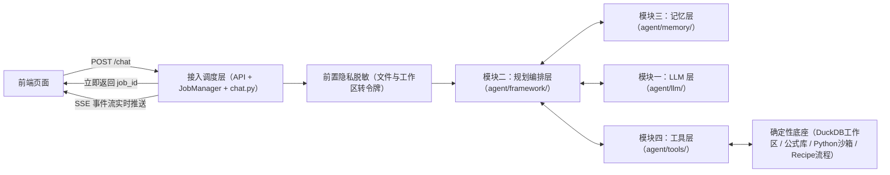
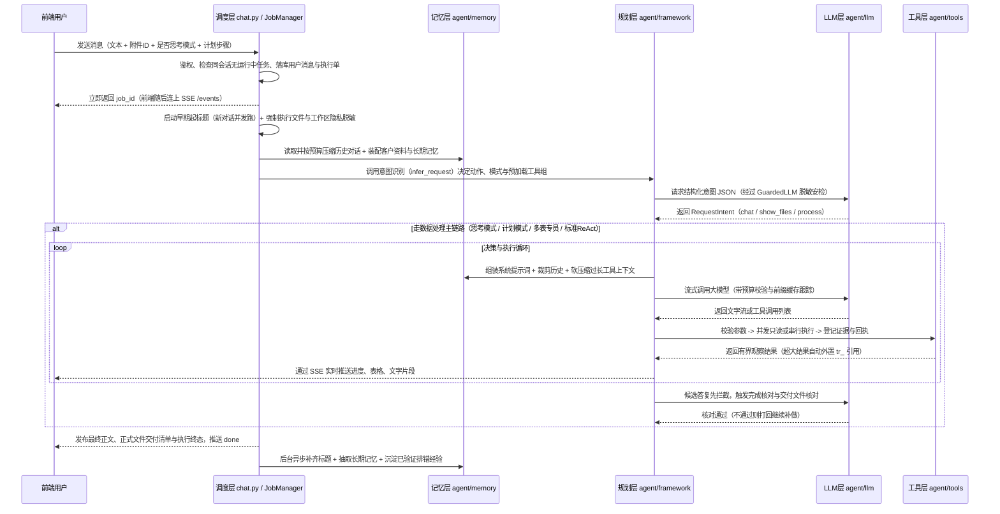
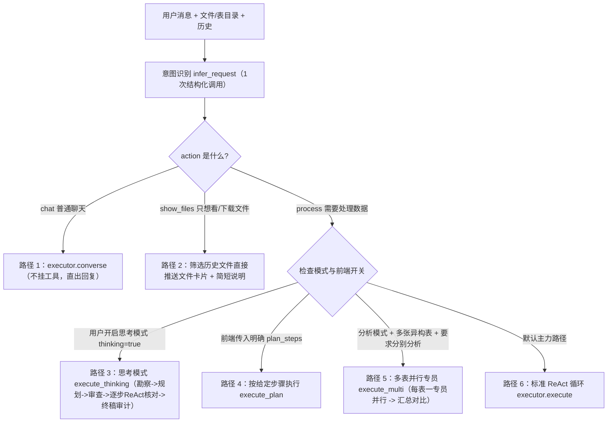
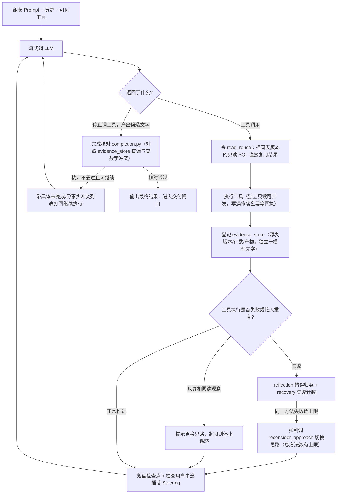
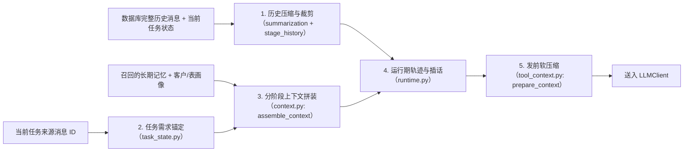
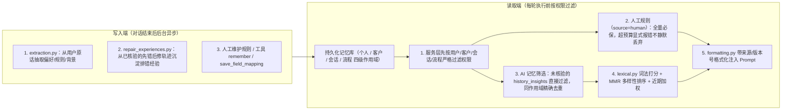
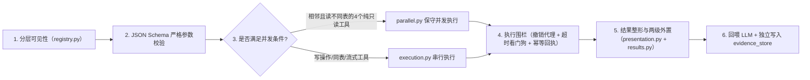

# SheetMate Agent 框架学习教程（按四大模块拆解逻辑与数据流）

> **阅读定位**：本教程严格基于 SheetMate **当前线上代码逻辑**整理，聚焦**流程层与数据流向**（不陷入逐行代码细节）。全文先用一张全景图串联“前端发来一条消息后后台发生了什么”，再按 **LLM 层 → 规划编排层 → 记忆层 → 工具层** 四大核心模块逐一拆解。

---

## 0. 全景鸟瞰：收到前端一条消息后，数据是怎么流转的？

### 0.1 四大模块的整体协作关系

SheetMate 的 `backend/sheetmate/agent/` 目录本身就天然划分成了 **4 大独立模块**，且严格遵守**领域与基础设施解耦**的原则（`agent/` 层不直接依赖 FastAPI 和数据库，所有文件、会话、持久化操作都通过宿主对象 `Host` 和上下文 `AgentContext` 注入）：

### 0.2 端到端主链路（从收到前端数据到推送完成）

**整条主链路里有 3 个最值得先记住的全局设计**：
1. **请求与执行解耦**：`/chat` 不等大模型跑完，而是立刻创建后台 `Job` 并返回 `job_id`，前端通过 SSE 持续收事件，刷新或短暂断连也不丢后台任务。
2. **先脱敏、再进大脑**：只要涉及表格文件，必须在调用任何正常大模型之前完成脱敏并把工作区切换成“令牌版”；中间任何一步脱敏未就绪，`GuardedLLM` 直接熔断拦截。
3. **先验货、再发货**：涉及修改、建表或脚本产出时，模型最后说出的总结会先被暂存在 `candidate` 缓冲区，等“完成核对 + 最终交付文件核对”全部通过后才正式发布给用户。

---

## 模块一：LLM 层（`agent/llm/`）——安全网关、协议适配与结构化输出

> **一句话定位**：LLM 层不只是对 OpenAI SDK 的简单封装，它是整套 Agent 的**脱敏安检门 + 多厂商思考协议翻译器 + 结构化 JSON 强校验引擎 + 全任务预算看门狗**。

### 1.1 模块内部数据流

### 1.2 核心处理逻辑拆解

| 子模块 | 对应职责 | 关键处理逻辑（流向与规则） |
|---|---|---|
| **强制脱敏拦截器** `guarded.py` | 所有正常模型调用的唯一外层包装（`get_llm()` 返回 `GuardedLLM`） | **发出前**：检查当前会话是否完成文件脱敏（未就绪直接抛 `PrivacyBlockedError`）；同步最新脱敏规则；把所有消息文本过一遍 `Guard` 替换敏感值，并在系统提示末尾追加 `token_legend`（放在末尾避免破坏前面静态提示词的缓存命中）。 **回来后**：**不在这里把令牌还原成真实值**——数据从上传起在 Agent 内部全程以令牌流转，直到最后下载文件或本地界面按权限展示时才在本机还原。 |
| **多厂商客户端与协议适配** `client.py` | 提供 `chat`、`stream_chat`、`complete_json` 三种调用形态 | 1. **思考方言自动翻译**：兼容 DeepSeek（`thinking: {type: enabled/disabled}` 及 `reasoning_content` 历史兼容）与 Qwen（`enable_thinking`），并支持让辅助调用自动关闭思考以提速。 2. **输出上限自适应**：自动探测服务端真实接受的 `max_tokens`；若服务端因输出参数报 400，解析报错中的窗口与输入信息自动降档重试并按 `(base_url, model)` 记住结果。 3. **流式完整性校验**：识别 `length` 截断、`content_filter`、空回复、残缺工具调用，以及部分自托管网关省略 `finish_reason` 的窄兼容修复。 |
| **结构化 JSON 与降级** `structured.py` `client.py` | 供意图识别、规划、核对、记忆抽取等需要严格字段的环节使用 | 1. **协议三级降级**：按 `json_schema` → `json_object` → `prompt` 顺序尝试，一旦确认端点不支持某模式则缓存降级结果（TTL 30 分钟），避免每次重复试错。 2. **本地强校验与精准纠错**：不管远端支不支持，返回结果都在本地走 Draft202012 JSON Schema 校验，失败时带回精确的 JSON Pointer 路径让模型局部修复，绝不自动乱猜或强转类型。 3. **辅助调用容错（`aux_json`）**：计划审查、步骤核对、回答审计这类辅助环节全部走限时 `aux_json`；超时或异常时不抛出中断主流程，而是返回失败原因供上层降级并如实告知用户。 |
| **全任务预算与缓存观测** `budget.py` `cache.py` | 防止单次任务失控烧钱，并持续观测 Prompt Caching 命中率 | 1. **任务级统一记账（`RequestBudget`）**：一次用户请求内的主循环、子专员、规划与核对共享同一个预算对象，在发出前卡住调用次数、估算输入/总 Token 与总耗时上限。 2. **确定性序列化（`stable_request`）**：把字典 Key 和 `tools` 清单排序后发送，并记录相邻两次请求的系统提示、工具定义、消息前缀 SHA-256 哈希变化（判定 `identical` / `append_only` / `rewritten`），配合厂商返回的 `cached_tokens` 做命中率统计。 |

---

## 模块二：规划与执行编排层（`agent/framework/`）——大脑路由、思考规划与 ReAct 闭环

> **一句话定位**：决定“这件事该怎么干、分几步干、干错了怎么自救、干完了怎么证明没胡说”。由 `shared/`（公共意图与提示词）、`planning/`（思考模式规划）、`react/`（执行循环、纠错与多专员）三部分构成。

### 2.1 第一步：意图分流（`shared/intent.py`）与五条执行路径

在正式进入执行前，编排层先把用户消息、历史上下文、工作区表目录、文件清单交给 `infer_request` 做一次结构化意图判断，产出一份 `RequestIntent` 路由单，决定接下来的去向：

`infer_request` 还会顺手产出 4 个关键控制信号，避免后续重复调模型：
- `mode`：`analyze`（只读分析）、`modify`（修改加工）、`create`（从零新建工作簿）；
- `save_recipe` / `save_recipe_cancelled`：严格判断用户是否明确授权“把本次做法保存成可复用流程”；
- `task_relation`：判断是开启全新任务（`new`）还是继续补充上一任务（`continue`）；
- `tool_groups` 与 `memory_candidate`：提前预告需要预加载哪些重型工具组，以及本轮是否可能包含值得后台抽取的长期记忆。

### 2.2 核心执行引擎：标准 ReAct 主循环（`react/executor.py`）

无论直接跑 ReAct，还是在思考模式的“每一步”、多专员的“每个分支”内部，底层干活的都是同一个 `AgentExecutor` 循环：

**ReAct 主循环里最核心的 4 个防翻车机制**：
1. **读结果复用（`read_reuse.py`）**：对纯确定性只读 `run_sql`，按 `SQL + 源表精确版本 + 读取质量` 算指纹，本轮内已经成功查过的直接复用结果，既省时间又避免“复用被当成新证据”。
2. **结构化报错自愈（`reflection.py` + `recovery.py`）**：
   - 把常见表格技术报错分成 5 类（`missing_column` 缺列、`missing_table` 缺表、`date_parse` 日期解析、`type_mismatch` 类型不匹配、`merged_cell` 合并单元格），给出确定性排查建议；
   - 限制同一种方法的连续失败次数（`METHOD_FAILURE_LIMIT`），撞墙后强制要求模型调用 `reconsider_approach` 明确说明“原方法问题 + 新方案 + 校验目标”才能换招，总方法数也有上限（`MAX_METHODS`），杜绝死磕。
3. **证据驱动的完成核对（`completion.py`）**：
   - 模型停止输出后，独立核对助手只相信 `evidence_store` 里的真实工具结果，绝不轻信模型口头说的“已核对完毕”；
   - 既查“有没有漏掉子目标”，也查“候选答复里的数字、全称判断（所有/均/没有）和真实证据有没有冲突”；有冲突就列出 `contradictions` 打回重写；同时有防死循环兜底（连续 4 轮核对器自己不收敛时标注争议项放行）。
4. **运行中插话（Steering）与断点续跑**：
   - 每次检查点之间都会轮询用户是否发来了补充要求，一旦收到就无缝吸收进当前目标并触发新一轮核对；
   - 每次工具调用前先在数据库登记 `started` 回执，完成后记 `completed`；重启恢复时，已完成的直接复原结果，**副作用未确认的绝不盲目重放**。

### 2.3 思考模式：四段式严谨闭环（`planning/`）

当用户开启“思考模式”面对复杂需求时，系统会在 ReAct 外面再套一层“先勘察、再规划、再审查、逐步验、终稿审”的闭环：

1. **只读数据勘察（`data_brief`）+ 起草计划（`make_plan`）**：
   - 不消耗大模型，直接从工作区抽取每张表的真实列类型、空值率、样本、候选主键和重复键告警；
   - 让模型据此写出开场理解、默认口径、潜在风险和最多 8 步计划，每步写清**具体验收标准**。
2. **计划审查（`review_plan`）**：
   - 另起一次辅助调用，对照用户需求和真实数据画像找遗漏、查不存在的列名、纠顺序错误。
3. **逐步执行 + 独立步骤核对（`step_verdict`）+ 局部修复（`repair_unfinished_plan`）**：
   - 每一项步骤内部跑一次完整 ReAct，并维护全局证据台账 `_Ledger`；
   - 步骤跑完后另起一次 `step_verdict` 只看该步的真实工具结果判断是否达标；不达标先就地补做；所有步骤过完一轮后，如果还有未完成项，最多做一轮整体补修（已达标步骤绝不重做）。
4. **综合汇总 + 回答核对（`answer_audit`）**：
   - 最终答复先扣住不发，对照 `_Ledger` 里的各步工具结果做最后一次事实审计，确认无数字出入后再放给用户，并在界面下方附带结构化核对标记。
   - **降级保护**：思考模式里所有辅助调用都有超时兜底，一旦模型服务卡住，会平滑降级并如实告知用户，不会拖死整次请求。

### 2.4 多表并行专员模式（`react/multi_agent.py`）

- **严格触发条件**：同时满足“分析模式 + 至少 2 张**不同结构**的上传表 + 用户明确说了分别/各自/独立分析 + 不含联表/对账/合并等跨表词”，才会激活（如果是同一张表的两个月份明细，必须跨表 JOIN/UNION，交给单 Agent 反而更准）。
- **隔离并发 + 汇总**：
  - 每张表分配一个专员，通过 `table_filter={table_name}` 物理限制其视野与工具权限（只能查自己的表，不能写文件、不能改流程/记忆），并按表切分工具预算，同时预留协调器汇总预算；
  - 全部专员完成后，汇总 LLM 拿到各专员结论，做跨表综合对比，并用 `[一致]` / `[待确认]` 标注可信度。

---

## 模块三：记忆层（`agent/memory/`）——短期上下文工程与长期业务记忆

> **一句话定位**：解决 Agent 的两大经典难题——**“上下文太长撑爆窗口 / 越聊越晕”**（短期记忆）与 **“下次再来忘了客户规矩和踩过的坑”**（长期记忆）。

整套记忆层贯穿一条核心铁律：**“源数据永不篡改，只做可恢复的投影；凡是因预算省略的内容，必须明明白白告诉模型怎么回查原文。”**

### 3.1 短期记忆与上下文工程（`memory/short_term/`）

数据在发给大模型前，会依次经过 5 个短期记忆组件的整理：

1. **分阶段预算与源感知拼装（`context.py`）**：
   - 不同环节给不同上限：`execution` 系统预算 22,000 Token、历史 12,000 Token；`planning` / `specialist` 系统 16,000、历史 8,000；`chat` 系统 10,000、历史 8,000。
   - 每个拼装块（`ContextBlock`）标明来源、作用域和是否 `required`：**必要规则绝不静默截断**（放不下直接报 `ContextOverflow`）；可选参考块只按整行裁剪（防止截断半个 JSON 或数字），并在末尾附带省略清单和回查工具指引。
2. **历史压缩与兜底锚定（`summarization.py`）**：
   - 对话历史超预算时，先触发模型自动压缩旧轮次成持久化摘要（auto-compact），并保留开场目标（primer）；
   - 如果压缩来不及或预算吃紧，`bounded_history` 会死保**第一条用户目标 + 最新一条用户要求**，再放摘要和近期轮次，其余省略的历史把 `message_id` 列出来，提示模型用 `inspect_conversation_history` 回查原文。
3. **任务需求锚定（`task_state.py`）**：
   - 独立于聊天摘要窗口，持久化记录当前任务对应的所有用户 `source_message_ids` 与附件 ID；
   - 区分新任务（清空旧锚点）和补充修改（保留原始要求 + 追加修正），长对话里也不会丢掉最初的完整需求，超长时可调 `inspect_task_context` 分页回看。
4. **运行期热状态（`runtime.py`）**：
   - 管理单次执行过程中的可恢复状态：模型消息循环、用户中途插话 `steers`、计划进度与检查点序列化。
5. **超长工具上下文软压缩（`tool_context.py`）**：
   - 每次调用 LLM 前检查整包请求大小；一旦超过目标字符数的 80%（默认 80,000 字符），**保持最近 8 条工具结果原样不动**，把更早的旧工具调用回合整体折叠成“带 `evidence_id`、源表版本与紧凑样例的进度摘要”，不修改历史原记录，需要细节仍可调 `inspect_execution_evidence` 回查。

### 3.2 长期记忆生命周期（`memory/long_term/` + `services/memory/`）

**长期记忆的 4 个核心守则**：
- **四类分层**：`preferences`（偏好）、`domain_knowledge`（业务规则）、`user_context`（背景信息）、`history_insights`（排错经验）；另外客户级的“字段别名映射（`field_mappings`）”与“表结构画像（`table_profiles`）”独立沉淀复用。
- **人工至上，绝不暗丢**：用户手工维护的规则权重最高且必须全量进入上下文；如果人工规则本身超出 6,000 字符预算，系统会明确提示精简规则（`MemoryContextLimit`），绝不悄悄截断。
- **排错经验必须有“核验证据”**：AI 自己猜的旧结论不自动进入提示词；只有真正“先触发 5 类技术报错 → 后续工具修复成功 → 整轮通过完成核对”后由后端自动沉淀的 `verified_repair` 经验，才会被召回。
- **精准检索与多样去重**：在已通过权限过滤的候选集上，先做同作用域精确去重（绝不乱合并数字或否定词不同的相似规则），再通过词法相关性 + MMR（避免把 5 条意思差不多的规则占满名额）+ 近期优先选出高价值记忆；未全部展示时，模型仍可调 `inspect_saved_memories` 按关键词回查。

---

## 模块四：工具层（`agent/tools/`）——分级按需暴露、安全执行与有界观察

> **一句话定位**：Agent 操作数据的“手脚与感官”。核心理念是**“重数据留本地引擎，轻观察喂大模型；重型工具按需加载，超大结果外置分页”**。

### 4.1 当前 8 大工具能力地图

| 工具类别 | 代表工具 | 核心作用 |
|---|---|---|
| **1. 数据探测与 SQL** `analysis/` | `table_info`、`value_counts`、`column_stats`、`preview_table`、`run_sql` | 首选数据处理工具：查表画像（按表版本缓存复用）、列分布统计、分页看数、在 DuckDB 分析副本上跑只读 `SELECT` 并可选落成带版本的结果表 |
| **2. 文件操作** `files/` | `list_files`、`load_file`、`export_excel`、`show_files` | 查可访问文件与准确 ID、把文件载入工作区、导出单表为 Excel、向界面展示文件卡片 |
| **3. 确定性公式** `formulas/` | 内置清洗/匹配/汇总公式 + 客户自定义公式 | 预置高频确定性表格变换（如筛选、分组、查找匹配、透视等），比手写脚本更稳、更省 Token |
| **4. Python 脚本技能** `scripts/` | `run_python_script`、`inspect_python_script` | 处理复杂报表清洗、样式保留、多 Sheet 复杂 Excel 加工，在隔离脚本沙箱中运行 |
| **5. 新建工作簿技能** `workbooks/` | `create_workbook`、`inspect_workbook_creation` | 从零设计结构化、带公式和专业排版的 Excel 模板与报表 |
| **6. 可复用流程（Recipe）** `workflows/` | `build_recipe`、`run_recipe`、`revise_recipe`、`save_as_recipe`、`get_recipe`、`edit_recipe_nodes`、`delete_recipes` 等 | 把验证过的处理步骤固化为可重复执行的确定性流水线，支持可视化查看、精准改节点/改名与二次复跑 |
| **7. 记忆与上下文回查** `memory/` & `registry.py` | `remember`、`save_field_mapping`、`read_tool_result`、`inspect_execution_evidence`、`inspect_task_context`、`inspect_conversation_history`、`inspect_saved_memories` | 沉淀用户明确说出的规则/别名映射；按 `tr_`、`ev_`、`message_id`、`memory_id` 分页回查被裁剪或外置的原始细节 |
| **8. 人机交互** `interaction/` | `ask_user` | 需求存在真实业务歧义（不同口径会导致明显不同结果）时，给出 2～4 个选项向用户提问并暂停等待回答 |

### 4.2 工具调用全生命周期（从模型选工具到结果回喂）

**工具层的 5 套核心设计**：
1. **核心工具默认精简 + 分组按需加载（`registry.py`）**：
   - 普通分析轮默认走 `core` 组，只把低成本的高频读写和回查工具放进 Prompt，把 `workbook`、`python`、`workflow`、`formulas` 四组重型工具定义收起来，显著降低每轮输入 Token 并提高前缀缓存命中率；
   - 需要时既可由意图识别阶段提前激活，也可由模型调用 `load_tool_group` 下一轮按需展开；
   - 多专员分支受到 `_BRANCH_TOOL_NAMES` 白名单约束，绝不能擅自改文件、写记忆或删流程。
2. **严格参数校验 + 执行安全围栏（`execution.py` + `worker.py`）**：
   - 工具调用前统一走 JSON Schema 校验，参数类型错或漏必填字段直接返回清晰纠错信息让模型重调，不带病执行；
   - 执行时给工作区和宿主套上 `_CallCapability` 撤销代理（任务被用户点“停止”或超时后，迟到的后台线程一旦试图再碰工作区立刻被拦截），并与全局看门狗联动清理。
3. **保守只读并发（`parallel.py`）**：
   - 仅当模型一轮吐出多个相邻调用、且全部属于 4 个显式标记安全的只读工具（`table_info` / `value_counts` / `column_stats` / `preview_table`）、且**操作的是不同表**时，才打包并发执行；绝不重排顺序，写操作严格串行，保证状态确定性。
4. **版本锚定的有界表格观察（`presentation.py`）**：
   - `preview_table` 和 `run_sql` 返回给模型的表格观察严格控制在 **8,000 字符** 内，按完整行返回绝不拦腰截断单元格；
   - 若表太大一次装不下，自动附带 `expected_revision`（表内容版本号）和 `next_call` 续读参数；如果中途表被修改导致版本号变了，继续按旧偏移翻页会被直接拒绝，防止拼出前后错位的脏数据。
5. **双层结果溢出外置（`results.py`）**：
   - 单个工具返回超过 50,000 字符，或单轮累计超过 200,000 字符时，优先把最大的结果安全落盘并分配一个 `tool_result_id=tr_...` 引用；
   - 对话消息里只留约 2,000 字符的结构化预览，完整结果随时可通过 `read_tool_result(result_id="tr_...", ...)` 分页读回，既不撑爆窗口也不丢细节。

---

## 5. 实战串讲：用一条真实请求把 4 大模块连起来

假设场景：**用户上传了《10月运费明细.xlsx》和《报价表.xlsx》，开启思考模式，发送：“剔除退货单后按报价表核对运费差异，生成一份汇总对账 Excel。”**

| 阶段 | 主导模块 | 输入是什么 | 做了什么核心处理 | 输出变成什么 |
|---|---|---|---|---|
| **1. 接入与安检** | 调度层 `chat.py` + `privacy` | 前端消息 + 2 个附件 ID | 建执行单并立即返回 `job_id`；扫描两张 Excel 把手机号/地址换成令牌并切换工作区；新对话顺手异步起标题 | 工作区就绪（纯令牌表）；前端连上 SSE 看到脱敏报告 |
| **2. 记忆与上下文备料** | **记忆层** `agent/memory` | 会话历史 + 客户记忆库 + 表目录 | 按预算压缩/裁剪历史（锚定首尾用户要求）；召回客户人工规则（必保）+ 词法/MMR 筛选相关 AI 记忆；绑定当前任务 `task_state` | 拼装好的分阶段系统提示词与受控历史 |
| **3. 意图分流** | **规划层** `shared/intent` + **LLM 层** `GuardedLLM` | 用户原话 + 表/文件目录 + 历史 | 经脱敏安检调结构化 JSON，判定 `action=process`、`mode=modify`、`save_recipe=false`，预加载 `python`/`formulas` 工具组，因开启思考模式进入 `execute_thinking` | `RequestIntent` 路由单 |
| **4. 勘察、规划与审查** | **规划层** `planning/` + **LLM 层** `aux_json` | 工作区两张表 + 用户需求 | `data_brief` 只读勘察列名/空值率/主键；`make_plan` 起草 3 步计划与验收标准；`review_plan` 查漏纠错 | 终版计划推给前端展示紧凑进度清单 |
| **5. 逐步执行与自愈** | **规划层** `react/executor` + **工具层** `agent/tools` + **LLM 层** | 每步目标 + `core` 及按需工具 | 步骤 1-2 并发只读探测表结构 → 跑 DuckDB `run_sql` 核对差异（大表走有界分页 + 读复用）；若遇类型不匹配报错由 `reflection`/`recovery` 引导修复；步骤 3 调沙箱脚本生成汇总 Excel；每步记录 `evidence_store` 与检查点，跑完过 `step_verdict` 核验 | 核验通过的差异表 + 候选交付 Excel + 完整证据台账 `_Ledger` |
| **6. 终稿核对与交付** | **规划层** `completion`/`audit` + 调度层 `delivery` | 候选总结文字 + 候选 Excel + `_Ledger` | 候选文字先扣住不发，对照真实证据核对所有金额与笔数；交付闸门筛选出正式交付文件（隐藏中间临时文件）；全部通过后正式推送正文与下载链接，定格终态落盘 | 用户看到准确总结 + 可下载（本机还原真实联系信息）的正式 Excel |
| **7. 后台进化** | **记忆层** `long_term` + 调度层异步任务 | 本轮消息、最终答复与修复轨迹 | 在推送 `done` 后异步执行：补齐标题、抽取用户新立的长期业务规则、若本轮经历过“先错后修并验真”则沉淀为已验证排错经验 | 系统越来越熟悉该客户口径，且不拖慢用户等待 |

---

## 6. 顺着逻辑看源码的推荐顺序

如果你想结合本教程进一步读代码，按下面 4 步从主干到枝叶看最快：
1. **看总调度入口**：[chat.py](file:///Users/xingkong/PycharmProjects/sheetmate/backend/sheetmate/services/conversations/chat.py)（搜索 `infer_request` 与 `execute_thinking` / `executor.execute` 的分支路由）
2. **看 LLM 层**：[guarded.py](file:///Users/xingkong/PycharmProjects/sheetmate/backend/sheetmate/agent/llm/guarded.py) → [client.py](file:///Users/xingkong/PycharmProjects/sheetmate/backend/sheetmate/agent/llm/client.py) → [structured.py](file:///Users/xingkong/PycharmProjects/sheetmate/backend/sheetmate/agent/llm/structured.py) → [budget.py](file:///Users/xingkong/PycharmProjects/sheetmate/backend/sheetmate/agent/llm/budget.py)
3. **看规划编排层**：[intent.py](file:///Users/xingkong/PycharmProjects/sheetmate/backend/sheetmate/agent/framework/shared/intent.py) → [prompt_builder.py](file:///Users/xingkong/PycharmProjects/sheetmate/backend/sheetmate/agent/framework/shared/prompt_builder.py) → [react/executor.py](file:///Users/xingkong/PycharmProjects/sheetmate/backend/sheetmate/agent/framework/react/executor.py) → [completion.py](file:///Users/xingkong/PycharmProjects/sheetmate/backend/sheetmate/agent/framework/react/completion.py) → [planning/executor.py](file:///Users/xingkong/PycharmProjects/sheetmate/backend/sheetmate/agent/framework/planning/executor.py)
4. **看记忆层与工具层**：[context.py](file:///Users/xingkong/PycharmProjects/sheetmate/backend/sheetmate/agent/memory/short_term/context.py) / [tool_context.py](file:///Users/xingkong/PycharmProjects/sheetmate/backend/sheetmate/agent/memory/short_term/tool_context.py) / [selector.py](file:///Users/xingkong/PycharmProjects/sheetmate/backend/sheetmate/agent/memory/long_term/retrieval/selector.py) → [registry.py](file:///Users/xingkong/PycharmProjects/sheetmate/backend/sheetmate/agent/tools/registry.py) / [execution.py](file:///Users/xingkong/PycharmProjects/sheetmate/backend/sheetmate/agent/tools/execution.py) / [results.py](file:///Users/xingkong/PycharmProjects/sheetmate/backend/sheetmate/agent/tools/results.py)

> 如后续项目规模扩大、准备做演进优化或面试系统梳理，可随时对照之前沉淀的 [Agent后台架构深度审计与演进优化方案.md](file:///Users/xingkong/PycharmProjects/sheetmate/docs/Agent后台架构深度审计与演进优化方案.md)。
