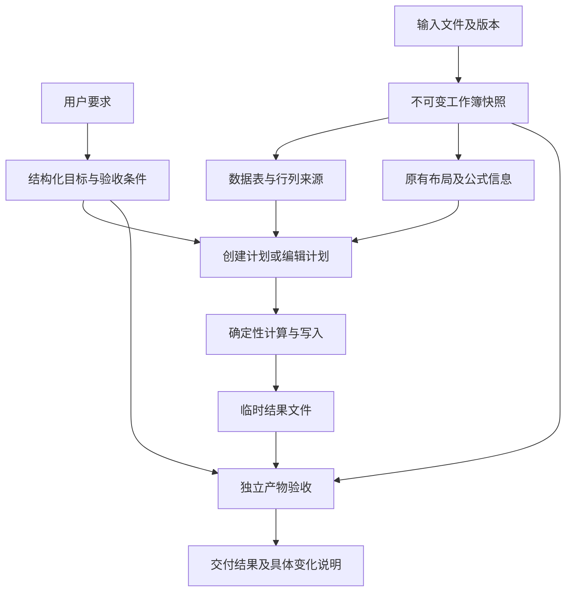

# Excel 建表与编辑：准确性和性能优化分析

分析日期：2026-11-12。本文的问题和测量描述的是修改前基线。首轮优化已实施；已交付范围、回归结果和新测量见 [Excel 优化实施记录](/Users/xingkong/PycharmProjects/sheetmate/docs/Excel优化实施记录.md)。后文的完整目标架构仍包含后续建议，不能视为全部已经实现。

**核心判断**

现有“独立原件副本、声明式建表、DuckDB 计算、模板写回”的方向可继续沿用。下一阶段应把重点放在三个方面：记录和列的来源可追踪；修改语义及验收条件明确；一次解析和计算的结果可复用。它们既提高准确性，也减少重复读取、模型猜测与重试。

优先级最高的准确性问题是排序后记录与样式错位、关键校验未执行却汇总为通过，以及建表时编号精度和公式有效性缺少约束。优先级最高的性能问题是重复整本解析、逐步生成 Excel 中间文件、工具执行时传输无关数据，以及重复创建样式对象。

**1. 当前值得保留的基础**

| 能力 | 当前实现 | 下一步应如何利用 |
| --- | --- | --- |
| 原件保护 | 独立副本、输出路径检查、临时文件写出 | 继续保留；通过复用不可变快照减少重复复制和解析 |
| 声明式建表 | `WorkbookSpec`、`table` 数据绑定、`cells` 补丁、`base_file_id` 布局继承 | 在现有规格上增加列语义、区域布局和公式规则 |
| 确定性计算 | 内置公式编译为 SQL，DuckDB 执行；复杂步骤可用 Python | 为内置算子增加来源传播和明确的输出关系类型 |
| 数据质量检查 | 公式缓存缺失、错误值、截断、合计、唯一性等检查 | 统一必需规则的状态语义，并验证最终落盘文件 |
| 执行保障 | 版本检查、取消、工具回执、过程快照、断点恢复 | 优化快照格式和传输范围，保持这些保障 |
| 缓存与统计 | 查询版本缓存、探测复用、模型用量、总体耗时统计 | 补解析、进程启动、样式处理、序列化等阶段指标 |

参考：[建表工具规格](/Users/xingkong/PycharmProjects/sheetmate/backend/sheetmate/agent/tools/workbooks/skill.py:41)、[计算执行入口](/Users/xingkong/PycharmProjects/sheetmate/backend/sheetmate/engine/formulas/runner.py:56)、[工作区版本检查](/Users/xingkong/PycharmProjects/sheetmate/backend/sheetmate/engine/tables/workspace.py:156)、[统计服务](/Users/xingkong/PycharmProjects/sheetmate/backend/sheetmate/services/observability/metrics.py:118)。

**2. 准确性：已确认的问题及影响**

| 优先级 | 发现与证据 | 影响 | 建议 |
| --- | --- | --- | --- |
| P0 | 同列、同行数即按原位置更新。临时实验中，排序后订单 B 留在原订单 A 的红底、批注、超链接上，且无警告 | 数据正确但记录附属信息错误 | 显式传播行来源；区分改值和移动记录 |
| P0 | 必需校验规则执行异常可变为 `warn`；汇总先判断 `warn` 再判断 `not_evaluated` | 存在未执行的必需检查时仍显示“校验通过，有警告” | 规则先编译检查，必需规则未执行不能汇总为通过 |
| P0 | 将 `1234567890123456789` 作为整数建表，回读得到 `1.234567890123457e+18` | 长编号丢精度 | 编号使用显式文本类型；金额、数量、比例分别声明语义 |
| P0 | `=SUM(` 通过当前公式对象校验并写入文件 | 文件生成成功不能说明公式有效 | 增加受支持范围内的语法、引用及计算验证 |
| P1 | 继承布局使用字段整体替换；仅传 A 列宽后，B 的显式列宽配置消失 | “只改一列”可能影响其他列 | 增加版本化的键级补丁，删除用明确操作 |
| P1 | 仅内置 `group_aggregate` 及下游明确标记汇总；通用 SQL 仅有表级来源 | SQL 聚合或复杂 JOIN 可能被当作原 sheet 编辑 | 显式输出目标和关系类型，减少模板选择启发式 |
| P1 | 重建数据区仅采样前两行样式；新列按粗粒度数据类型借样式 | 合计、特殊标记行及金额/比例等格式可能不合适 | 记录样式与布局样式分开；新列按业务语义选格式 |
| P1 | Python 可直接生成并交付文件，常规模板写出器不一定参与 | 不同工具的保真能力不一致 | 统一实际产物验收入口，常规脚本优先返回数据或编辑计划 |

代码位置：[按位置写回](/Users/xingkong/PycharmProjects/sheetmate/backend/sheetmate/engine/workbooks/template_writer.py:302)、[校验汇总](/Users/xingkong/PycharmProjects/sheetmate/backend/sheetmate/recipe/validation/rules.py:19)、[建表类型及公式](/Users/xingkong/PycharmProjects/sheetmate/backend/sheetmate/engine/workbooks/builder.py:78)、[布局继承](/Users/xingkong/PycharmProjects/sheetmate/backend/sheetmate/agent/tools/workbooks/skill.py:58)、[输出计划](/Users/xingkong/PycharmProjects/sheetmate/backend/sheetmate/recipe/definition/templating.py:36)、[脚本执行服务](/Users/xingkong/PycharmProjects/sheetmate/backend/sheetmate/services/scripts/execution.py:93)。

校验状态实验使用两条 `severity=error` 规则：合计规则指向不存在的列，唯一性规则未指定列。输入金额为 10、20，输出为 999、999；返回 `status=warn`、`not_evaluated=1`，摘要为“校验通过，有 1 项警告”。这证明规则未执行的状态可以被掩盖；它不代表有效配置的合计规则无法识别数值错误。

当前已有 DataFrame 业务规则、文件存在性与可读性、部分交付文件增删契约及脚本 `check`，并非完全没有产物验证。缺少的是统一核对最终文件中“数据、公式、记录附属信息和非目标区域”是否符合修改计划。

**3. 性能：已经测到的开销**

以下均为本机合成实验，不包含模型和网络耗时，不能外推真实端到端提速倍数。工作簿读写实验环境为 Python 3.13.11、openpyxl 3.1.5、pandas 3.1.0。

| 合成场景 | 当前测量 | 说明 |
| --- | --- | --- |
| 4 个 sheet，每张 1000 行、8 列；读取其中一张 | 0.273 秒，2 次 `load_workbook` | 3 次中位数；当前 `read_sheet` 内部读取整本 |
| 相同文件一次读取全部 sheet | 0.275 秒，2 次加载 | 3 次中位数；与读取一张几乎相同 |
| 分别调用 4 次 `read_sheet` | 1.164 秒，8 次加载 | 3 次中位数；整本重复解析 |
| 相同文件修改一个 sheet 并导出 | 0.595 秒，3 次加载 | 3 次中位数；每张修改表只改变一个值 |
| 修改全部 4 个 sheet 并导出 | 1.558 秒，9 次加载 | 3 次中位数；每张修改表再次读整本 |
| 新建 2000 行 × 12 列，无区域样式 | 0.383 秒 | 单次实验 |
| 相同建表，全区字体、对齐、填充、边框 | 2.544 秒，其中样式处理 2.146 秒 | 单次实验；样式处理约占 84% |
| 预览 5 行：1 张小表 | 工具函数约 2.2 毫秒；当前子进程路径约 422.9 毫秒 | 3 次中位数；直接调用仅作开销对照，不是替换方案 |
| 预览 5 行：工作区 8 张表，各 2 万行、4 列 | 全状态子进程约 551.4 毫秒；只传目标表约 429.9 毫秒 | 3 次中位数；复用已有只读分支测量 |
| 2 万行、输出 5 列的一步结果 | 计算约 4.1 毫秒；转 DataFrame 3.3 毫秒；写 XLSX 514.7 毫秒 | 3 次中位数；中间文件序列化明显重于计算 |

具体性能问题与改法：

1. **一次解析，多处复用。** `read_sheet` 调用 `read_workbook`，每次读全部工作表并分别打开公式和缓存值视图；模板写出对每张目标 sheet 再次调用它。创建后，文件登记和载入工作区也各读一遍。建议建立请求内的不可变解析结果，复用现有文件版本信息，并把 sheet 选择下推到读取层。保留公式/缓存一致性检查；允许一次实际落盘回读同时服务验收、画像和工作区载入。参考 [reader.py](/Users/xingkong/PycharmProjects/sheetmate/backend/sheetmate/engine/workbooks/reader.py:116)、[创建服务](/Users/xingkong/PycharmProjects/sheetmate/backend/sheetmate/services/conversations/host.py:329)。
2. **内部检查点使用适合数据的存储。** 每一步成功后同步取完整 DataFrame 并写 XLSX，再继续下一步。建议保存带版本的 DuckDB 表或列式快照，用户查看或下载某一步时再生成 Excel；保留历史不可变、断点恢复和追溯能力。参考 [过程快照](/Users/xingkong/PycharmProjects/sheetmate/backend/sheetmate/recipe/execution/runner.py:633)。
3. **子进程只接收依赖数据，只返回变化。** 普通数据工具当前会导出整个工作区，启动进程重建表，再返回全状态。先扩展现有目标表选择，再传输增量结果；随后评估可取消、可替换的常驻 worker。保留输入版本冲突检测、取消和失败时不发布结果。参考 [worker.py](/Users/xingkong/PycharmProjects/sheetmate/backend/sheetmate/agent/tools/worker.py:28)。
4. **编译并复用样式。** 当前逐格复制字体、对齐并重建填充和边框。先将相同填充、边框移到循环外，再按“原样式＋覆盖属性”缓存最终样式；合并重复规则，保持重叠规则的应用顺序。参考 [样式执行](/Users/xingkong/PycharmProjects/sheetmate/backend/sheetmate/engine/workbooks/builder.py:282)。
5. **消除局部高复杂度循环。** 筛选写回中，循环每一行都会重新构造 `set(matched)`。16000 行、保留一半的局部算法实验中，当前写法中位数 0.789 秒，预先构造一次集合为 0.000601 秒，结果完全相同；这是局部算法对照，不是完整任务提速。另应检查每个合并区域扫描全部结果值、每个单元格调用 DataFrame `iloc` 等热点。参考 [删除行定位](/Users/xingkong/PycharmProjects/sheetmate/backend/sheetmate/engine/workbooks/template_writer.py:317)。

**4. 推荐的目标结构**

基于现有 `WorkbookSpec`、`OutputPlan`、Recipe 和执行回执演进。让模型负责确定业务目标和规则，让引擎负责解析坐标、类型转换、公式展开、样式应用和验证。

**4.1 修改表：从最终结果推断，升级到显式编辑计划。**

计划应记录输入文件版本、目标工作表或区域、操作类型、来源映射、前置条件、允许变化及验收条件。最先支持 `set_cells`、`filter_rows`、`sort_rows`、`add_column`、`append_sheet`；随后扩展行列结构修改。

例如“按金额排序订单”应确定：排序区域、金额类型、并列值的稳定顺序、各记录移动前后位置，以及哪些属性跟记录移动。人工标记、批注、超链接通常随记录；标题、列宽、冻结窗格和斑马纹按布局处理。隐藏行、公式和条件格式应按操作语义分别定义，不能一律移动或一律固定。

行来源可表达为文件版本、sheet、源行；列来源使用稳定列标识，列名只是展示名称。内置筛选、排序、改值、一对一匹配首先传播来源。一对多结果显式记录复制关系，聚合结果保留组级来源。未知 SQL/Python 结果标记为来源未验证，不能靠行数相等认定原位修改。来源标识必须跨结果表重建保持可追踪，不能把当前结果表的物理行号直接当成原记录身份。

不要直接把隐藏 ID 塞进所有业务 SQL：它会影响 `SELECT *`、`DISTINCT`、聚合和 JOIN。使用内部伴随映射或受控编译；不支持的关系形状先选择可验证的输出路径，不能将猜测标记为精确保留。

现有 `OutputSheet` 可增加可选的目标文件、目标 sheet、区域与编辑/追加意图，新流程显式填写，旧流程保留兼容推断。输出时校验输入版本及必要旧值，避免把补丁应用到已经变化的版本。

**4.2 做表：让模型描述区域、列和规则。**

在已有 `table`、`cells`、`base_file_id` 上增加：

- 区域：标题、说明、明细、汇总、签字区；由引擎计算相对位置和大小。
- 列语义：编号、文本、数量、金额、比例、日期；同时确定存储类型、显示格式、允许空值及舍入规则。
- 列计算：例如“金额＝数量×单价”，引擎批量生成每行公式和合计范围；大批真实数据继续按工作区表引用传入。
- 样式角色：标题、表头、正文、金额、合计，编译为少量复用样式；允许单元格精细覆盖。
- 增量修订：列宽、行高按键更新；合并区域显式增加/移除；相同样式重复应用不无限累积。升级规格版本，保留旧字段整体替换的兼容性。

金额计算建议根据业务选择 Decimal/定点精度，明确舍入发生在逐行还是汇总后。比例明确 0.15 与 15 的单位差异。不能仅靠 pandas 的整数/浮点类型来决定格式，也不能把所有大数自动改成文本。

公式分别记录“已写入”“语法和引用已验证”“计算结果已验证”。先覆盖常用公式和当前需求；需要完整计算结果的任务再选择具备相应能力的计算引擎。打开时重算标记不能替代服务端计算验证。

数据与布局应分别版本化，快照引用不可变的数据块，保存布局差异；避免每次改一个标题都重复持久化完整网格。

**4.3 统一实际文件验收，按影响范围控制成本。**

复用已有业务校验和文件检查，补一个所有交付路径共用的产物核对入口：

| 操作 | 必需检查 |
| --- | --- |
| 改值 | 指定单元格值和类型正确；受保护区域无意外变化 |
| 筛选/排序 | 结果记录及顺序正确；附属信息随正确记录移动；相关公式和范围符合约定 |
| 新增列 | 标题、数据、公式和显示单位正确；其他列的内容及样式按约定保留 |
| 建表 | 所有区域存在且无意外覆盖；绑定数据数量及内容一致；编号和公式通过对应检查 |
| 汇总/匹配 | 合计、唯一性、匹配基数及覆盖率符合业务规则 |
| 脚本文件 | 通过相同业务契约和保真检查；脚本自报成功不能替代独立验收 |

先根据编辑计划确定受影响区域和依赖，再读取并验证实际临时文件。普通操作做局部核对及受保护部分的指纹检查；结构操作扩大到关联公式、验证规则和合并区域。样式比较应使用规范化后的属性，不能只比较可能重编号的样式 ID。

必需规则失败或未执行时，完成状态不能为通过。可选检查可以有明确的“未执行”说明，不能掩盖必需检查。失败信息应指明文件、sheet、范围及预期/实际值，便于定点修复。

**4.4 模型往返：按任务复杂度选择执行深度。**

简单任务如改标题、列宽、指定区域数值和已有规则的筛选，可以直接形成一次结构化计划，确定性执行和验证后生成结论。多个有依赖的操作通过一个计划执行，避免每一步都等待模型再次决策。

多表关联、业务口径不清、复杂排版和验证冲突继续使用规划、探测及修复。已有证据充足且版本未变时复用探测结果；计划局部失败只修受影响步骤及下游，避免重新生成整张表。通过真实任务评测决定哪些模型审查可以由确定性验收替代，保留完成证据约束。

当前思考模式通常在每步 ReAct 完成核对后又做步骤核对，最终整理回答后再做回答审计，存在合并同一验收范围的机会。并非每次都会走完所有检查，应基于调用轨迹决定可合并项。参考 [步骤和回答审查](/Users/xingkong/PycharmProjects/sheetmate/backend/sheetmate/agent/framework/planning/executor.py:554)。标题和记忆提取已存在后台执行路径，不应重复列为待实现的提速措施。

查询缓存和模型缓存也需要区分：当前 SQL 缓存按依赖表版本组织，但新建 worker 的工作区无法复用父进程缓存，`import_state` 还会无条件清缓存；可先按实际变更表失效。模型缓存代码主要稳定请求和统计服务商返回的缓存用量，并不缓存模型答案。参考 [缓存失效](/Users/xingkong/PycharmProjects/sheetmate/backend/sheetmate/engine/tables/workspace.py:183) 和 [模型缓存说明](/Users/xingkong/PycharmProjects/sheetmate/backend/sheetmate/agent/llm/cache.py:1)。

现有独立只读工具可并行；同一个工作簿的结构写入应由一个计划协调。外部模型耗时尚未在本轮测量，不应声称减少某几个调用就能保证总耗时下降多少。

**4.5 OOXML 局部写入作为后续专用路径。**

先限定为结构不变、修改范围明确的单元格值更新，在副本上只改必要包部件。实现时必须处理字符串、单元格类型、公式及缓存、关联部件，并核对未涉及部件。行列移动、复杂引用和对象依赖继续走有能力验证的路径。其价值是提高复杂文件的保真上限，投入应放在来源追踪和验收基础具备之后。

**5. 建议分批落地**

| 批次 | 内容 | 主要模块 | 完成标准 |
| --- | --- | --- | --- |
| 第一批：准确性缺口与直接开销 | 修复必需校验状态；补排序来源检查、编号精度和非法公式案例；布局键级补丁；预构造保留行集合；样式复用 | 校验规则、建表规格、模板写出、建表工具 | 已复现问题有回归用例；不再把未验证项标为通过；局部性能对照有效 |
| 第二批：统一创建和修改基础 | 来源传播、显式目标与编辑计划；请求内解析复用；统一实际文件验收 | reader、Workspace 元数据、内置算子、OutputPlan、服务交付 | 常用改值/筛选/排序/新增列来源明确；各工具交付使用同一验收入口 |
| 第三批：规模化提速与丰富建表 | 内部列式快照、依赖数据传输、可取消 worker 复用；区域布局、列公式、增量版本 | Recipe runner、数据 worker、builder、布局存储 | 多步大表不反复生成中间 XLSX；大数据不经模型重抄；频繁修订成本受控 |
| 后续：复杂文件专用能力 | 局部 OOXML 修改、扩展公式计算、复杂对象能力路由 | 专用读写与计算适配器 | 明确支持范围内通过真实工作簿回归与保真核对 |

第一批里的简单优化可独立发布；稳定来源需跨读取、计算和写出链路推进，不能仅在 writer 内补一个“猜行来源”的函数就认为完成。

**6. 如何衡量“更准确、更快”**

准确性使用固定回归集，覆盖编号前导零与长编号、日期和金额、空值/空字符串、排序与重复记录、筛选后重编号、样式与批注、公式和跨 sheet 引用、合并与分组表头、SQL 聚合和 JOIN、脚本输出、连续修订以及取消重跑。对声明支持的案例要求目标修改正确、保护条件满足；无法验证应给出明确状态。

性能按“小表简单修改”“多 sheet”“大表多步处理”“复杂样式建表”分组，记录端到端 P50/P95、模型调用数、首个有效结果时间、整本解析次数、进程启动次数、传输字节、样式处理时间、保存/校验时间及峰值内存。已有统计服务继续使用，补齐阶段数据即可。

建议先设可检查的工程目标：同一版本在同一请求内解析结果可复用；只读单表工具不传无关表；内部检查点不强制生成 XLSX；重复样式修订不无限膨胀；必需校验无遗漏。真实任务的延迟目标应在建立统一机器、数据规模和模型条件的基线后确定。

**7. 本次验证范围**

- 已运行 `backend/.venv/bin/python -m pytest backend/tests/test_template_output.py backend/tests/test_template_row_deletion.py backend/tests/test_template_preservation_edges.py -q`，结果 **23 passed in 2.83s**。
- 临时合成实验验证了排序附属信息错位、长整数回读精度损失、非法公式被写入、布局字段替换及校验状态混淆，并测量了上述读写、样式、工具进程和过程快照开销。
- 本轮未调用真实模型做端到端性能测试，也未基于用户业务文件估算生产性能。已有测试通过说明已覆盖能力没有在本轮审查中发现回归，不代表新增发现已经修复。
